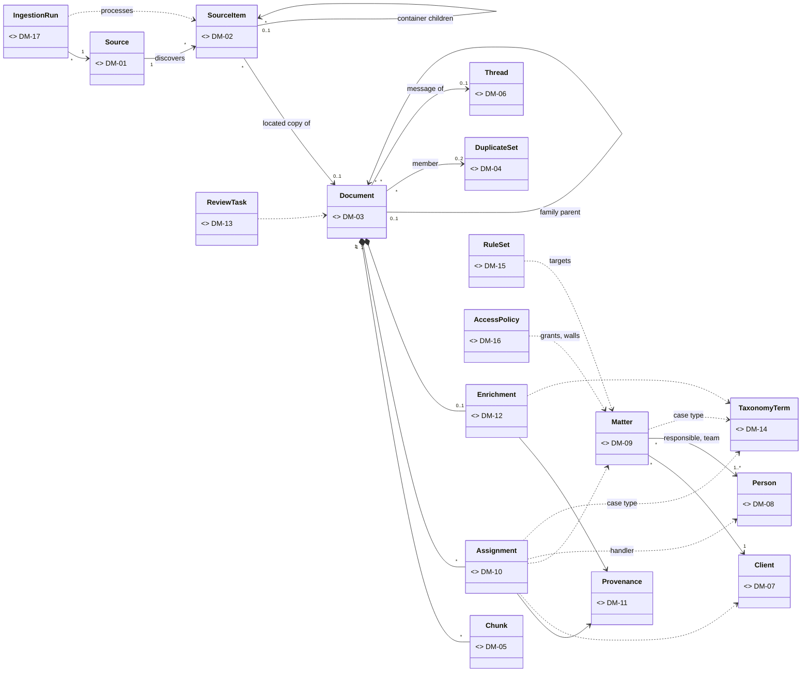
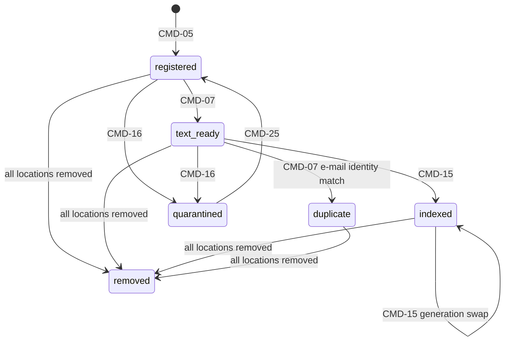
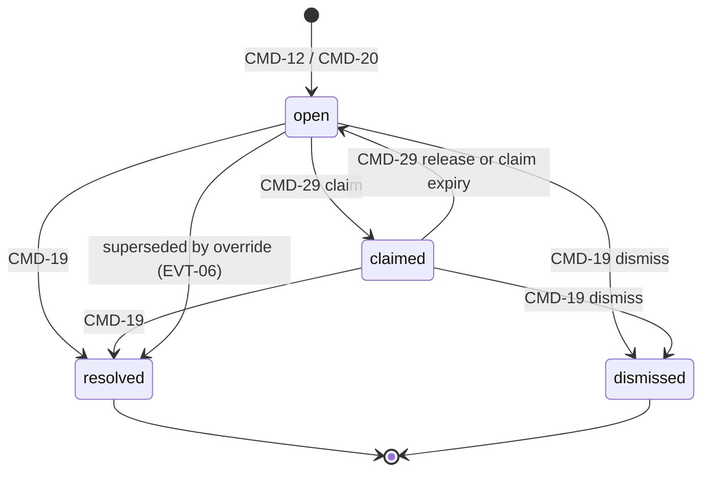
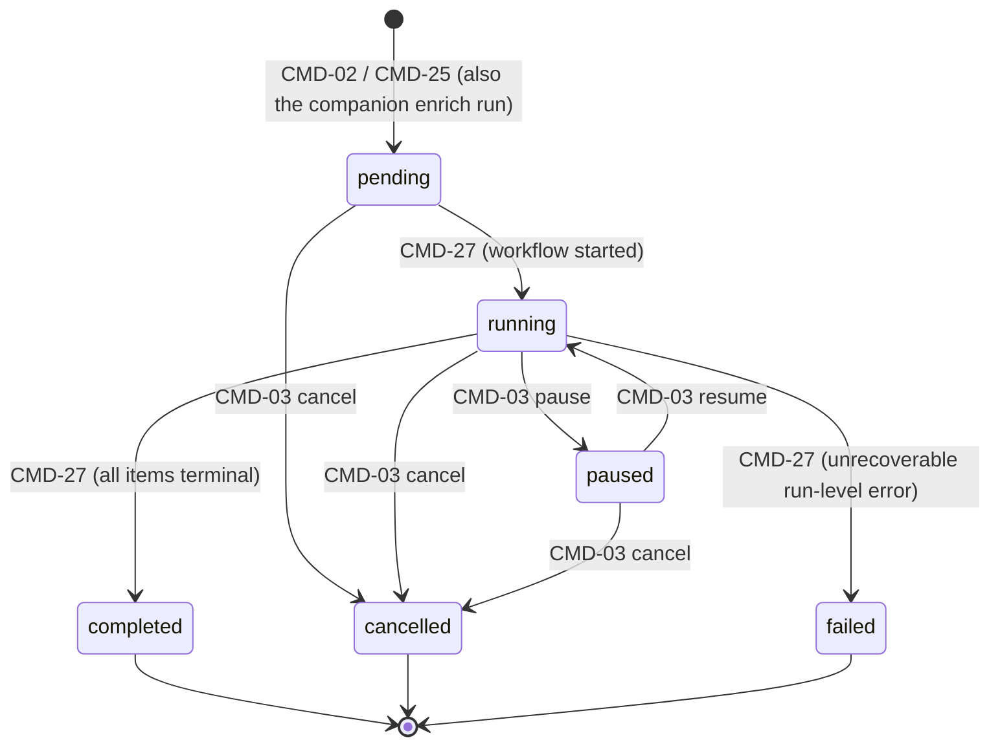

# Domain model

This file owns the domain model: entities, value objects and aggregates (DM-), their invariants (DM-NN.M), domain events (EVT-) and the controlled vocabularies (TAX-). The code lives in `docstore.domain` ([MOD-02](overview.md#mod-02)) and does no I/O ([ARCH-03](overview.md#arch-03)). Commands that change these objects are in [application.md](application.md); how aggregates are persisted is owned by the repository ports ([PORT-05](ports-adapters.md#port-05) to [PORT-09](ports-adapters.md#port-09)). Field names below are the Python attribute names; column names match them.

All aggregates carry `version: int` for optimistic locking, and `created_at` / `updated_at` timestamps. These are not repeated per item. Identifiers are UUIDv7 unless stated otherwise.

## Relationships

| Item | Kind | Repository port |
|---|---|---|
| [DM-01](#dm-01) Source | aggregate root | [PORT-07](ports-adapters.md#port-07) |
| [DM-02](#dm-02) SourceItem | aggregate root | [PORT-07](ports-adapters.md#port-07) |
| [DM-03](#dm-03) Document | aggregate root (owns [DM-05](#dm-05), [DM-10](#dm-10), [DM-12](#dm-12)) | [PORT-05](ports-adapters.md#port-05) |
| [DM-04](#dm-04) DuplicateSet | aggregate root | [PORT-05](ports-adapters.md#port-05) |
| [DM-05](#dm-05) Chunk | entity inside [DM-03](#dm-03) | [PORT-05](ports-adapters.md#port-05) |
| [DM-06](#dm-06) Thread | aggregate root | [PORT-05](ports-adapters.md#port-05) |
| [DM-07](#dm-07) Client | aggregate root | [PORT-06](ports-adapters.md#port-06) |
| [DM-08](#dm-08) Person | aggregate root | [PORT-06](ports-adapters.md#port-06) |
| [DM-09](#dm-09) Matter | aggregate root | [PORT-06](ports-adapters.md#port-06) |
| [DM-10](#dm-10) Assignment | value object inside [DM-03](#dm-03) | [PORT-05](ports-adapters.md#port-05) |
| [DM-11](#dm-11) Provenance | value object | (embedded) |
| [DM-12](#dm-12) Enrichment | entity inside [DM-03](#dm-03) | [PORT-05](ports-adapters.md#port-05) |
| [DM-13](#dm-13) ReviewTask | aggregate root | [PORT-08](ports-adapters.md#port-08) |
| [DM-14](#dm-14) TaxonomyTerm | aggregate root | [PORT-09](ports-adapters.md#port-09) |
| [DM-15](#dm-15) RuleSet | aggregate root | [PORT-09](ports-adapters.md#port-09) |
| [DM-16](#dm-16) AccessPolicy | entities plus a pure policy | [PORT-06](ports-adapters.md#port-06) |
| [DM-17](#dm-17) IngestionRun | aggregate root | [PORT-07](ports-adapters.md#port-07) |
| [DM-18](#dm-18) DomainEvent | value object | (dispatched, [PORT-19](ports-adapters.md#port-19)) |

## Ingestion and content

### DM-01 Source

A configured content origin ([GL-01](../README.md#gl-01)). Created and changed by [CMD-01](application.md#cmd-01).

- **DM-01.1 Fields.** `source_id`, `name` (unique), `kind` ∈ {`filesystem`, `sharepoint`, `pst`}, `settings` (kind-specific JSON, schema in [CMD-01](application.md#cmd-01)), `settings_hash` (sha256 of canonical settings JSON), `unassigned_access_group` (the group that may see this source's documents while they have no accepted matter, see [DM-16.7](#dm-16-7)), `data_use_reference` ([DM-01.5](#dm-01-5)), `enabled`.
- **DM-01.2 Discovery cursor.** `cursor` (opaque connector token, shaped by the connector adapter behind [PORT-16](ports-adapters.md#port-16)), `cursor_settings_hash`, `cursor_updated_at`. The cursor is the position after the last committed discovery page ([CMD-04](application.md#cmd-04)).
- **DM-01.3 Invariant: cursor validity.** A cursor is valid only while `cursor_settings_hash = settings_hash`. A settings change that alters scope clears the cursor, so the next run does full discovery.
- **DM-01.4 Invariant: disabled sources.** A source with `enabled = false` accepts no new ingestion run ([DM-17.6](#dm-17-6)).
- **DM-01.5 Invariant: data-use authorisation.** `data_use_reference` is required and non-empty: a reference to the DPIA record covering this source, or a sample-data declaration ([SCOPE-04.6](../README.md#scope-04-6)).

Refs: [DM-02](#dm-02), [PORT-16](ports-adapters.md#port-16), [SCOPE-04](../README.md#scope-04)

### DM-02 SourceItem

One discovered object in a source ([GL-02](../README.md#gl-02)), kept as its own aggregate because there are millions of them. It is the idempotency anchor for the pipeline ([ING-18](ingestion.md#ing-18)).

- **DM-02.1 Identity.** `source_item_id`, `source_id`, `source_key`, unique per (`source_id`, `source_key`). `source_key` is stable across runs and unique per source; the domain treats it as opaque. The formats are per connector ([ADP-17.2](ports-adapters.md#adp-17-2), [ADP-18.2](ports-adapters.md#adp-18-2), [ADP-19.1](ports-adapters.md#adp-19-1)), except for container children, whose key is `<parent source_key>/att/<ordinal>` ([CMD-06](application.md#cmd-06)).
- **DM-02.2 Change fingerprint.** `fingerprint` (opaque; changes when content or metadata change; the formats are per connector, see [ADP-17.2](ports-adapters.md#adp-17-2), [ADP-18.2](ports-adapters.md#adp-18-2), [ADP-19.2](ports-adapters.md#adp-19-2), [ADP-19.3](ports-adapters.md#adp-19-3); for a child it is the parent sha256 and ordinal), `revision` (incremented whenever the fingerprint changes), `removed_at_source_at` (set when the source reports deletion).
- **DM-02.3 Source metadata.** `display_path`, `source_meta` (JSON: SharePoint site, library and column values; PST folder path and mailbox owner; file owner), `parent_source_item_id`, `container_ordinal`, `document_id` (set once the item is fetched, [CMD-05](application.md#cmd-05)), `last_run_id`.
- **DM-02.4 Stage state.** `stages`: a map from stage key ([DM-02.5](#dm-02-5)) to {`status`, `attempts`, `last_error_class`, `last_error`, `updated_at`, `output_ref`, `run_id` (the run that last reset or handed off the stage), `handed_off_at` (stage-2 stages only, set by the handoff of [ING-14.4](ingestion.md#ing-14-4))}. Status values are [DM-02.6](#dm-02-6).
- **DM-02.5 Stage keys.** `fetch` [ING-02](ingestion.md#ing-02), `dedup` [ING-03](ingestion.md#ing-03), `expand` [ING-04](ingestion.md#ing-04), `extract` [ING-05](ingestion.md#ing-05), `ocr` [ING-06](ingestion.md#ing-06), `link` [ING-07](ingestion.md#ing-07), `neardup` [ING-08](ingestion.md#ing-08), `rules` [ING-09](ingestion.md#ing-09), `reconcile` [ING-11](ingestion.md#ing-11), `chunk` [ING-12](ingestion.md#ing-12), `embed` [ING-13](ingestion.md#ing-13), `index` [ING-14](ingestion.md#ing-14), `enrich` [ING-10](ingestion.md#ing-10), `llm_reconcile` [ING-19](ingestion.md#ing-19), `meta_index` [ING-20](ingestion.md#ing-20). The keys are grouped into stage 1 and stage 2 by [ING-21.1](ingestion.md#ing-21-1); their order is the step order of [WF-02.2](ingestion.md#wf-02-2) and [WF-07.2](ingestion.md#wf-07-2).
- **DM-02.6 Stage status values.** `waiting` (stage-2 stages only: not yet handed off; set `pending` by the stage-1 handoff of [ING-14.4](ingestion.md#ing-14-4) or by a selection-mode enrich run, [CMD-28](application.md#cmd-28)), `pending`, `done`, `skipped` (not applicable, for example `ocr` on a born-digital file; for stage-2 stages, a duplicate, a `no_text` document or an enrichment that is already current), `failed` (retryable), `quarantined` (terminal until reprocessed), `excluded` (terminal; an exclude rule of the source settings matched, named in `excluded_by`; set on `fetch` by [CMD-04](application.md#cmd-04), later stages stay unset). Error classes come from [XC-05](overview.md#xc-05).
- **DM-02.7 Invariant: stage order.** Within a stage group ([ING-21.1](ingestion.md#ing-21-1)), a stage can be `done` only if every earlier stage of that group is `done` or `skipped`. Stage-2 stages additionally require stage-1 `index` to be `done`. No stage-1 stage ever depends on a stage-2 stage.
- **DM-02.8 Invariant: revision reset.** A new `revision` resets every stage-1 stage to `pending` and every stage-2 stage to `waiting`. A stage that is `done` for the current revision is never executed again, except by explicit reprocessing ([CMD-25](application.md#cmd-25)).
- **DM-02.9 Invariant: quarantine.** `quarantined` requires `last_error_class` and `last_error`. It is cleared only by reprocessing or a new revision.

Refs: [DM-01](#dm-01), [DM-03](#dm-03), [ING-18](ingestion.md#ing-18), [ING-21](ingestion.md#ing-21)

### DM-03 Document (aggregate root)

The unit of indexing ([GL-03](../README.md#gl-03)): a file, e-mail, attachment or embedded object. It owns its chunks ([DM-05](#dm-05)), assignments ([DM-10](#dm-10)) and enrichment ([DM-12](#dm-12)).

- **DM-03.1 Identity.** `document_id`, `sha256` (of the original bytes), `email_identity_hash` (e-mails only, [DM-04.2](#dm-04-2)), `kind` ∈ {`file`, `email`, `attachment`, `embedded`}.
- **DM-03.2 Locations.** `locations`: a list of {`source_item_id`, `source_id`, `display_path`, `first_seen_at`, `last_seen_at`, `removed`}. One document can have many locations because byte-identical copies are collapsed ([DM-03.11](#dm-03-11)).
- **DM-03.3 Format and text.** `mime_type`, `format_class` ([TAX-06](#tax-06)), `size_bytes`, `page_count`, `has_text_layer`, `ocr_applied`, `ocr_mean_confidence`, `text_ref` (blob key of the extracted UTF-8 text, [PORT-17](ports-adapters.md#port-17)), `text_sha256`, `char_count`, `language` (ISO 639-1), `no_text` (true when extraction and OCR yield no text), `near_dup_signature` (MinHash, [DM-04.3](#dm-04-3)).
- **DM-03.4 E-mail headers.** `message_id`, `in_reply_to`, `references[]`, `conversation_index`, `subject`, `normalised_subject` (lower-cased, `RE:`/`FW:`/`AW:`/`WG:` prefixes and whitespace stripped), `from_addr`, `to_addrs[]`, `cc_addrs[]`, `bcc_addrs[]`, `sent_at`, `received_at`, `mailbox_owner` (person ID resolved from the PST or source metadata).
- **DM-03.5 Family.** `family_id` (the `document_id` of the family root), `parent_document_id`, `child_ordinal`, `attachment_name` ([GL-04](../README.md#gl-04)).
- **DM-03.6 Dates.** `created_at_source`, `modified_at_source`, `ingested_at` and the derived `document_date` ([DM-03.17](#dm-03-17)).
- **DM-03.7 Native metadata.** `title`, `author`, `native_meta` (JSON: Office core properties, PDF info dictionary, SharePoint column values).
- **DM-03.8 Organisation links.** `assignments[]` ([DM-10](#dm-10)), `enrichment` ([DM-12](#dm-12)), `thread_id` ([DM-06](#dm-06)), `duplicate_set_ids` (at most one per kind, [DM-04](#dm-04)), `access_keys[]` ([DM-16.7](#dm-16-7)).
- **DM-03.9 Lifecycle.** `status` ∈ {`registered`, `text_ready`, `indexed`, `duplicate`, `quarantined`, `removed`}, `active_chunk_generation`, `pending_chunk_generation`. Transitions are shown in [DM-03.10](#dm-03-10).
- **DM-03.10 Lifecycle state machine.** Re-extraction, re-chunking or re-embedding of an `indexed` document writes a new pending chunk generation; the document stays `indexed` on its active generation until [CMD-15](application.md#cmd-15) swaps the generations.

- **DM-03.11 Invariant: one document per sha256.** `sha256` is unique and immutable. A byte-identical copy found at another location adds a location and never creates a second document.
- **DM-03.12 Invariant: family shape.** A child has exactly one parent, the parent is an `email` or a container, the family graph has no cycles, the nesting depth is at most 5, and every member's `family_id` equals the root's `document_id`.
- **DM-03.13 Invariant: searchable.** A document is searchable only if `status = indexed`, `active_chunk_generation` is set, and every chunk of that generation has an embedding from the configured model ([DM-05.6](#dm-05-6)). The exception is `no_text` documents, which are indexed on metadata only and have no chunks. Searchability never depends on enrichment: stage-2 status has no effect on this invariant ([ING-21](ingestion.md#ing-21)).
- **DM-03.14 Invariant: access keys.** `access_keys` are recomputed in the same transaction as any change to accepted matter assignments, and are copied to all chunks in that transaction ([DM-05.7](#dm-05-7)).
- **DM-03.15 Version stamps.** `parser_version`, `ocr_version`, `near_dup_algo_version`, `ruleset_version`, `prompt_version`, `llm_model`, `chunker_version`, `embedding_model`. Each stamp is written only by the command that produces the derived data. The stage-2 `enrichment_version` (hash of `prompt_version` and `llm_model`) is derived from these stamps, not stored separately on the document. Stale-stamp detection is governed by [XC-06](overview.md#xc-06).
- **DM-03.16 Invariant: duplicates are not indexed.** A document with `status = duplicate` has no chunks, is not enriched, and contributes its locations and `mailbox_owner` as additional facts to the canonical member's rule evaluation ([DM-04.6](#dm-04-6)).
- **DM-03.17 Rule: document date.** `document_date` is the first of these that is available: `sent_at`; the accepted enrichment key date of kind `document_date` ([DM-12](#dm-12)); `created_at_source`; `modified_at_source`.

Refs: [DM-04](#dm-04), [DM-05](#dm-05), [DM-06](#dm-06), [DM-10](#dm-10), [DM-12](#dm-12), [XC-06](overview.md#xc-06), [CMD-05](application.md#cmd-05), [CMD-07](application.md#cmd-07), [CMD-16](application.md#cmd-16), [CMD-25](application.md#cmd-25)

### DM-04 DuplicateSet

A group of documents that are the same message or nearly the same text ([GL-20](../README.md#gl-20)). Byte-identical copies are not sets; they are locations of a single document ([DM-03.11](#dm-03-11)).

- **DM-04.1 Fields.** `set_id`, `kind` ∈ {`email_identity`, `near`}, `key` (the e-mail identity hash or the LSH band key of the first member), `canonical_document_id`, `members[]` {`document_id`, `similarity`}, `algorithm_version`.
- **DM-04.2 Rule: e-mail identity.** `email_identity_hash` is the sha256 of the normalised `Message-ID` (lower-cased, angle brackets stripped). Without a `Message-ID` it is the sha256 of `from_addr`, `sent_at` (UTC, to the second), `normalised_subject` and the body text sha256. The same message exported from two mailboxes, or as both PST entry and MSG file, gets the same hash.
- **DM-04.3 Rule: near duplicate.** Two documents are near duplicates when their estimated Jaccard similarity is at least 0.90 over 5-word shingles of the normalised text. The estimate uses MinHash with 128 permutations and LSH with 32 bands of 4 rows. Documents with fewer than 50 words are not compared.
- **DM-04.4 Rule: canonical member.** Born-digital beats OCR, then the earliest `document_date` wins, then the lowest `document_id`.
- **DM-04.5 Invariant: membership.** A document is in at most one set per kind. The canonical document is a member. A set that drops to one member is dissolved.
- **DM-04.6 Rule: effect by kind.** Non-canonical members of an `email_identity` set become `duplicate` ([DM-03.16](#dm-03-16)) and are hidden from search. Members of a `near` set stay indexed; the set only groups them for display and for exclusion in [QRY-13](application.md#qry-13).

Refs: [DM-03](#dm-03), [EVT-03](#evt-03)

### DM-05 Chunk

A token-bounded span of a document's text ([GL-06](../README.md#gl-06)), stored inside the [DM-03](#dm-03) aggregate. The size and overlap parameters are set in [ADR-12](decisions.md#adr-12).

- **DM-05.1 Fields.** `chunk_id`, `document_id`, `generation`, `ordinal`, `char_start`, `char_end`, `page_from`, `page_to`, `token_count`, `text`, `section_hint` (heading, e-mail part or sheet name).
- **DM-05.2 Embedding fields.** `embedding` (`halfvec(1024)`, nullable until [CMD-14](application.md#cmd-14)), `embedding_model` (format of [XC-06.1](overview.md#xc-06-1)), `embedded_at` ([GL-07](../README.md#gl-07)).
- **DM-05.3 Denormalised filter keys.** Copies of document values, written for filtering in the read model ([ADP-09](ports-adapters.md#adp-09)), in two groups:
  - Chunk-level keys, on every chunk row: `access_keys[]`, `client_ids[]`, `matter_ids[]`, `source_id`, `is_canonical`, `format_class` ([TAX-06](#tax-06)), `from_addr`, `participant_addrs[]` (lower-cased sender and all recipient addresses of an e-mail).
  - Document-level keys, once per document in the narrow read-model table `document_enrichment_keys` ([ADP-09.5](ports-adapters.md#adp-09-5)), which search joins by `document_id`: `handler_ids[]`, `case_type`, `doc_type`, `tags[]`, `document_date`, `enrichment_version` (null until stage 2 completes for the active text; written by [ING-20](ingestion.md#ing-20), and lets search show `enrichment_pending`). Stage 2 writes only this group, so it never updates `chunks` ([ADR-17.2](decisions.md#adr-17-2)).
- **DM-05.4 Invariant: contiguity.** Within one generation, ordinals run from 0 to n-1, offsets lie within the text, `char_start` never decreases, and `token_count` does not exceed the chunker maximum.
- **DM-05.5 Invariant: generation consistency.** All chunks in a generation come from the same `text_sha256` and `chunker_version`. A document has at most one active and one pending generation.
- **DM-05.6 Invariant: one embedding space.** Vectors are compared only when their `embedding_model` values are identical. The vector dimension must equal the model's declared dimension ([PORT-12](ports-adapters.md#port-12)).
- **DM-05.7 Invariant: inherited access.** A chunk's `access_keys` always equal its document's `access_keys` ([DM-03.14](#dm-03-14)).

Refs: [DM-03](#dm-03), [DM-16](#dm-16), [ADR-12](decisions.md#adr-12)

### DM-06 Thread

A reconstructed e-mail conversation ([GL-05](../README.md#gl-05)). Built by [CMD-08](application.md#cmd-08).

- **DM-06.1 Fields.** `thread_id`, `root_message_id`, `normalised_subject`, `participants[]` (addresses), `message_document_ids[]` (ordered by `sent_at`), `first_sent_at`, `last_sent_at`, `thread_matter_id` ([DM-06.4](#dm-06-4)).
- **DM-06.2 Rule: linking order.** A message joins a thread through the first of these that matches: (1) its `in_reply_to` or any `references` entry is a `message_id` already in the thread; (2) the first 22 bytes of its `conversation_index` match; (3) it has the same `normalised_subject`, at least one shared participant, and is no more than 30 days after `last_sent_at`. If nothing matches, a new thread is created.
- **DM-06.3 Invariant: single membership.** A message belongs to at most one thread. When a message links two threads, they merge into the older `thread_id`.
- **DM-06.4 Rule: thread matter.** `thread_matter_id` is set when all accepted `human` or `rule` matter assignments of the thread's messages agree; otherwise it is null. Only this value is used to propose `inherited` assignments to other messages in the thread. The stored value is a cache refreshed by the [EVT-04](#evt-04) handler; [CMD-10](application.md#cmd-10) evaluates the rule itself on the thread's current assignments.

Refs: [DM-03](#dm-03), [DM-10](#dm-10)

## Organisation

### DM-07 Client

A person or organisation the firm acts for ([GL-08](../README.md#gl-08)). Imported by [CMD-21](application.md#cmd-21).

- **DM-07.1 Fields.** `client_id`, `pms_client_id`, `kind` ∈ {`person`, `organisation`}, `name`, `aliases[]`, `email_domains[]`, `status` ∈ {`active`, `inactive`}.
- **DM-07.2 Invariant: PMS identity.** `pms_client_id` is unique and immutable.
- **DM-07.3 Invariant: domain ownership.** An e-mail domain belongs to at most one active client. Public mail domains on the deny list (for example `gmail.com`) cannot be client domains.

Refs: [DM-09](#dm-09)

### DM-08 Person

Firm staff or an external person ([GL-11](../README.md#gl-11)).

- **DM-08.1 Fields.** `person_id`, `kind` ∈ {`staff`, `external`}, `pms_person_id` (staff only), `initials`, `name`, `emails[]`, `aliases[]`, `staff_role` ∈ {`partner`, `associate`, `paralegal`, `secretary`, `other`} (staff only), `principal_id` (staff only, [DM-16.1](#dm-16-1)), `organisation_name` (external only).
- **DM-08.2 Invariant: unique addresses.** An e-mail address belongs to at most one person.
- **DM-08.3 Rule: external persons.** External persons are created when LLM party extraction ([DM-12](#dm-12)) or e-mail headers name someone who is neither staff nor an existing external person. Their party role is a [TAX-05](#tax-05) value held on the enrichment, not on the person.

Refs: [DM-09](#dm-09), [TAX-05](#tax-05)

### DM-09 Matter

An engagement for a client ([GL-09](../README.md#gl-09)). Imported by [CMD-21](application.md#cmd-21).

- **DM-09.1 Fields.** `matter_id`, `matter_code` (PMS code, for example `2024-0137`), `client_id`, `title`, `case_type_code` ([TAX-01](#tax-01)), `responsible_lawyer_id`, `team[]` {`person_id`, `role`} with roles from [TAX-04.1](#tax-04-1), `access_group`, `status` ∈ {`open`, `closed`, `archived`}, `opened_on`, `closed_on`, `keywords[]` and `counterparties[]` (hints for rules and LLM input).
- **DM-09.2 Invariant: references.** The client exists, the responsible lawyer is a `staff` person, and `case_type_code` is an active leaf term of [TAX-01](#tax-01).
- **DM-09.3 Invariant: codes and dates.** `matter_code` is unique and immutable, and `closed_on ≥ opened_on` when both are set.
- **DM-09.4 Rule: closed matters.** Closed and archived matters still accept assignments, because historical documents belong to them.

Refs: [DM-07](#dm-07), [DM-08](#dm-08), [DM-16](#dm-16), [TAX-01](#tax-01)

### DM-10 Assignment (value object)

A link from a document to a client, matter, handler or case type ([GL-12](../README.md#gl-12)). Proposed by [CMD-10](application.md#cmd-10) and [CMD-11](application.md#cmd-11), decided by [CMD-12](application.md#cmd-12) and overridden by [CMD-17](application.md#cmd-17). The rationale for rules-first is in [ADR-08](decisions.md#adr-08).

- **DM-10.1 Fields.** `target_kind` and `role` ([TAX-04.1](#tax-04-1)), `target_id`, `location_source_item_id` (optional; set when the proposal comes from one location's path or site), `status` ∈ {`proposed`, `accepted`, `rejected`, `superseded`}, `provenance` ([DM-11](#dm-11)), `decided_at`.
- **DM-10.2 Rule: method precedence.** `human` > `rule` > `inherited` > `llm` > `agent` (methods from [TAX-04.2](#tax-04-2)). A lower-precedence method never replaces an accepted assignment of a higher one.
- **DM-10.3 Invariant: cardinality.** At most one accepted `client`, `matter` and `case_type` assignment per document. The exception: a document with several locations may have one accepted client and matter per location, which covers the same file filed in two matters. `handler` assignments are unrestricted, one per (person, role).
- **DM-10.4 Invariant: known targets.** The target exists in reference data ([DM-07](#dm-07), [DM-08](#dm-08), [DM-09](#dm-09)) or the active taxonomy ([DM-14](#dm-14)). An LLM proposal for a matter must name one of the candidate matters it was given ([LLM-02](ingestion.md#llm-02)).
- **DM-10.5 Invariant: client follows matter.** An accepted matter implies an accepted client equal to the matter's `client_id` (method `inherited`). If a different client is accepted at the same or higher precedence, the conflict goes to review.
- **DM-10.6 Rule: reconciliation policy.** This pure function is applied per document and per target kind; it uses the bands of [TAX-04.3](#tax-04-3).
  1. If an accepted `human` assignment exists, it stands; new automated proposals are recorded as `superseded`.
  2. If one `rule` or `inherited` target scores at or above the auto-accept threshold, it is accepted. If an `llm` proposal at or above the review threshold names another target, a non-blocking `rule_llm_disagreement` review task is opened.
  3. If two `rule`/`inherited` proposals name different targets at or above the review threshold, nothing is accepted and a `conflict` review task is opened.
  4. `llm`-only proposals for `client` or `matter` are never auto-accepted. At or above the review threshold they open an `llm_only` review task; below it they are `rejected` and kept for evaluation.
  5. `llm`-only proposals for `handler` and `case_type` are auto-accepted at or above the threshold, because they do not affect access. Exception: when a matter is accepted, the case type is inherited from the matter, and an LLM case type that differs is recorded as `superseded`.
  6. When no matter is accepted and no candidate reaches the review threshold, the document stays unassigned, visible only through the source key ([DM-16.7](#dm-16-7)), and an `unassigned` review task with priority `low` is opened ([DM-13.2](#dm-13-2)).

  The policy is applied identically in stage 1 (before chunking, [ING-11](ingestion.md#ing-11)) and again in stage 2 ([ING-19](ingestion.md#ing-19)). The LLM never changes the confidence of a `rule` or `inherited` proposal (rule 2), so it cannot lift one over the auto-accept threshold ([DM-10.8](#dm-10-8)).
- **DM-10.7 Invariant: history.** Assignments are never deleted. Replaced ones become `superseded`, and the [EVT-04](#evt-04) trail records each change.
- **DM-10.8 Invariant: stage-2 access safety.** Because `llm` proposals for `client` and `matter` are never auto-accepted ([DM-10.6](#dm-10-6) rule 4) and rank below `rule`, `inherited` and `human` ([DM-10.2](#dm-10-2)), stage-2 reconciliation ([ING-19](ingestion.md#ing-19)) can never change accepted client or matter assignments, and so never changes `access_keys` ([DM-03.14](#dm-03-14), [LLM-06.4](ingestion.md#llm-06-4)).

Refs: [DM-11](#dm-11), [TAX-04](#tax-04), [ADR-08](decisions.md#adr-08), [ING-19](ingestion.md#ing-19)

### DM-11 Provenance (value object)

How a derived value was produced ([GL-16](../README.md#gl-16)). Attached to assignments, enrichment fields and extracted text.

- **DM-11.1 Fields.** `method` ([TAX-04.2](#tax-04-2)), `actor` (principal ID for `human` and `agent`, component name otherwise), `version` (`ruleset_version` and `rule_id` for `rule`; `llm_model`, `prompt_version` and `prompt_sha256` per [LLM-04](ingestion.md#llm-04) for `llm`; source assignment ID for `inherited`; `acts_for_principal_id` for `agent`; `parser_version` / `ocr_version` for `extractor`), `confidence` in [0, 1], `evidence` (short string: matched pattern, quoted span ≤ 200 chars, or reviewer comment), `produced_at`.
- **DM-11.2 Invariant: immutability.** Provenance is never edited. A new value gets new provenance.
- **DM-11.3 Invariant: completeness by method.** `human` requires an actor and has confidence 1.0. `llm` requires model, prompt version and prompt hash. `rule` requires a rule set version and a rule ID. `agent` requires the agent principal as actor and its `acts_for_principal_id` ([DM-16.1](#dm-16-1)).

Refs: [LLM-04](ingestion.md#llm-04), [XC-06](overview.md#xc-06), [TAX-04](#tax-04)

### DM-12 Enrichment

LLM-derived attributes of one document text version ([GL-15](../README.md#gl-15)), recorded by [CMD-11](application.md#cmd-11) in stage 2 ([WF-07](ingestion.md#wf-07)), after the document is already searchable. The field set mirrors the output schema of [LLM-03](ingestion.md#llm-03); this item owns how the fields are held and protected.

- **DM-12.1 Fields.** `document_id`, `text_sha256`, `status` ∈ {`ok`, `invalid_output`, `skipped`}, `fields`: a map from each [LLM-03](ingestion.md#llm-03) field name to an EnrichedValue, `superseded_at`.
- **DM-12.2 EnrichedValue.** `value`, `confidence`, `provenance` ([DM-11](#dm-11)), `state` ∈ {`auto_accepted`, `pending_review`, `rejected`, `human`}, `locked`.
- **DM-12.3 Invariant: controlled values.** `doc_type` is an active [TAX-02](#tax-02) term and `case_type` an active [TAX-01](#tax-01) leaf. `tags` are active or candidate [TAX-03](#tax-03) terms, at most 8. Party roles are [TAX-05](#tax-05) values. Key dates are ISO 8601. `summary` has at most 1,200 characters.
- **DM-12.4 Invariant: human lock.** A human-set field ([CMD-18](application.md#cmd-18)) has `locked = true` and `state = human`. Re-enrichment writes new values only to unlocked fields and carries locked fields forward unchanged.
- **DM-12.5 Invariant: text binding.** An enrichment is current only while its `text_sha256` equals the document's. The previous enrichment is kept with `superseded_at` set, for audit only.

Refs: [DM-11](#dm-11), [LLM-03](ingestion.md#llm-03), [TAX-02](#tax-02), [TAX-03](#tax-03)

### DM-13 ReviewTask (aggregate)

A queued human decision ([GL-19](../README.md#gl-19)). Opened by [CMD-12](application.md#cmd-12) or [CMD-20](application.md#cmd-20), resolved by [CMD-19](application.md#cmd-19).

- **DM-13.1 Fields.** `task_id`, `document_id`, `subject` (`assignment:<target_kind>`, `enrichment:<field>` or `other`), `reason` ([DM-13.2](#dm-13-2)), `priority` ∈ {`high`, `normal`, `low`}, `candidates[]` {`value`, `confidence`, `provenance`}, `opened_by` (principal or `system`), `comments[]`, `assignee_id`, `claimed_until`, `state`, `resolution` {`decision`, `value`, `resolver_id`, `comment`, `resolved_at`}.
- **DM-13.2 Reasons and default priority.** `conflict` (high), `rule_llm_disagreement` (normal), `llm_only` (normal), `low_confidence` (low), `invalid_llm_output` (low), `agent_flag` (normal), `human_flag` (normal), `tag_candidate` (low), `unassigned` (low; no matter accepted and no candidate at or above the review threshold, [DM-10.6](#dm-10-6) rule 6).
- **DM-13.3 State machine.** Claim and release are [CMD-29](application.md#cmd-29). A claim expires after 30 minutes without resolution.

- **DM-13.4 Invariant: one open task per subject.** At most one `open` or `claimed` task exists per (`document_id`, `subject`). A further flag on the same subject appends a comment and adds candidates. A later reconciliation on the same subject (for example stage 2 after stage 1) updates the open task in place: it adds candidates and raises `reason` and `priority` to the highest of the old and new reasons ([DM-13.2](#dm-13-2)).
- **DM-13.5 Invariant: resolution content.** `resolved` requires a decision (`accept_candidate`, `override` or `superseded`) and a resolver. `dismissed` requires a comment. Terminal states are final.

Refs: [DM-10](#dm-10), [DM-12](#dm-12), [TAX-04](#tax-04), [EVT-06](#evt-06)

### DM-14 TaxonomyTerm

A term in one of the controlled vocabularies [TAX-01](#tax-01), [TAX-02](#tax-02) and [TAX-03](#tax-03). Maintained by [CMD-23](application.md#cmd-23).

- **DM-14.1 Fields.** `vocabulary` ∈ {`case_type`, `doc_type`, `tag`}, `code` (for example `LIT.EMP` or `contract.nda`), `labels` {language → text}, `parent_code`, `synonyms[]`, `status` ∈ {`active`, `candidate`, `deprecated`}, `replaced_by`, `pms_code` (case types only), `proposal_count` (candidates only).
- **DM-14.2 Invariant: codes.** `code` is unique per vocabulary and immutable; renaming changes labels only.
- **DM-14.3 Invariant: hierarchy.** The parent is in the same vocabulary and the hierarchy has no cycles.
- **DM-14.4 Invariant: lifecycle.** Only `tag` terms can be `candidate`. A `deprecated` term cannot be newly assigned; its `replaced_by`, if set, must be active. Queries display a deprecated term as its replacement.
- **DM-14.5 Rule: taxonomy version.** Every change increments a global `taxonomy_version`, which is part of the LLM input contract ([LLM-02](ingestion.md#llm-02)).

Refs: [TAX-01](#tax-01), [TAX-02](#tax-02), [TAX-03](#tax-03)

### DM-15 RuleSet (aggregate)

Versioned deterministic assignment rules. Published by [CMD-24](application.md#cmd-24) and evaluated by [CMD-10](application.md#cmd-10).

- **DM-15.1 Fields.** `ruleset_version` (integer, starts at 1), `status` ∈ {`draft`, `published`, `retired`}, `published_at`, `published_by`, `comment`, `rules[]`.
- **DM-15.2 Rule fields.** `rule_id` (stable slug), `kind` ([DM-15.3](#dm-15-3)), `pattern`, `target_kind`, `target` (a fixed ID or a capture-group mapping such as `matter_code=$1`), `confidence`, `priority`.
- **DM-15.3 Rule kinds and typical confidence.** `matter_code_regex` over file name, subject and the first 2,000 characters of text (0.98); `path_glob` over a filesystem or exported path (0.95); `sharepoint_site` for a site or library (0.95); `pst_folder` for a PST folder path (0.90); `mailbox_owner` producing handler role `custodian` (0.99); `email_domain` matching sender or recipient domains to a client ([DM-07.3](#dm-07-3)) (0.75, client only); `sharepoint_column` for an exact or regex match on a library column, such as a matter-number column (0.97); `email_address` mapping a sender or recipient address to a client or handler (0.85). Together these are the deterministic stage-1 rule set: PMS-derived codes, SharePoint sites and columns, path and file-name rules and e-mail header rules ([ING-09](ingestion.md#ing-09)).
- **DM-15.4 Rule: evaluation.** Evaluation is a pure function of (document facts, reference data, rule set) that returns proposals with method `rule`. Every matching rule yields a proposal. Several proposals for the same target collapse to the highest confidence, and `priority` breaks ties between targets in a display. Facts come from all locations, including those of `duplicate` members ([DM-03.16](#dm-03-16)).
- **DM-15.5 Invariant: publication.** A published version is immutable, and exactly one version is `published` at a time; publishing retires the previous one. Every regex compiles, and every fixed target exists.

Refs: [DM-10](#dm-10), [ADR-08](decisions.md#adr-08)

### DM-16 AccessPolicy

Principals, groups, matter grants and ethical walls, plus the pure visibility rule that supplies the inputs for the permission predicate. Where and how the predicate is enforced is owned by [XC-01](overview.md#xc-01). Imported by [CMD-22](application.md#cmd-22).

- **DM-16.1 Principal.** `principal_id`, `kind` ∈ {`human`, `agent`, `service`}, `display_name`, `person_id` (humans), `acts_for_principal_id` (agents), `roles[]` ([DM-16.2](#dm-16-2)), `group_ids[]`, `active` ([GL-14](../README.md#gl-14)).
- **DM-16.2 Roles.** `member` (searches and reads what it can see), `reviewer` (works the review queue, overrides), `admin` (sources, runs, imports, taxonomy, rules), `auditor` (reads the audit trail), `agent` (MCP access), `worker` (the ingestion service identity). Roles authorise operations; they never widen document visibility.
- **DM-16.3 Group.** `group_id`, `name`, `members[]` (principal IDs), with no nested groups in the PoC.
- **DM-16.4 MatterGrant.** `matter_id`, grantee (principal or group), `valid_from`, `valid_to`. The matter's own `access_group` ([DM-09.1](#dm-09-1)) is an implicit grant.
- **DM-16.5 EthicalWall.** `wall_id`, `matter_id`, `excluded[]` (principals or groups), `reason`, `valid_from`, `valid_to` ([GL-13](../README.md#gl-13)).
- **DM-16.6 Rule: matter visibility.** At time t, principal P sees matter M if and only if P, or a group of P, holds an effective grant on M, and no effective wall on M excludes P or any group of P. A wall always beats a grant. No role bypasses walls.
- **DM-16.7 Rule: access keys and document visibility.** A document's access keys are strings (stored as `text[]`): `matter:<matter_id>` for each accepted matter assignment, or the single key `source:<source_id>` when it has none. This rule owns the key format and which keys a principal may see. P sees a `source:` key if P is in the source's `unassigned_access_group`. P sees the document if P sees at least one of its keys and no `matter:` key belongs to a matter that walls P. Clients, threads, families and persons are visible only through visible documents or matters; the derived rules are in the queries of [application.md](application.md).
- **DM-16.8 Rule: agent delegation.** An agent's effective visibility is the intersection of its own grants and those of `acts_for_principal_id`. An agent with no grants of its own inherits the human's grants unchanged.

Refs: [DM-09](#dm-09), [XC-01](overview.md#xc-01)

### DM-17 IngestionRun (aggregate)

One durable execution over a source scope or a selection ([GL-18](../README.md#gl-18)). Its workflow is [WF-01](ingestion.md#wf-01) (ingest), [WF-03](ingestion.md#wf-03) (reprocess) or [WF-06](ingestion.md#wf-06) (stage-2 enrich); how pause and recovery behave inside the workflow is [WF-05](ingestion.md#wf-05).

- **DM-17.1 Fields.** `run_id`, `run_key` (idempotency key, [CMD-02](application.md#cmd-02)), `kind` ∈ {`ingest`, `reprocess`, `enrich`}, `source_id` (ingest runs), `scope` (path prefixes, site or library IDs, PST files, `modified_since`), `selection` (reprocess runs and selection-mode enrich runs, [CMD-25.1](application.md#cmd-25-1)), `mode` ∈ {`incremental`, `full`}, `stages[]` (reprocess and enrich runs: stage keys of [DM-02.5](#dm-02-5)), `enrich_mode` ∈ {`follow`, `none`} (ingest and reprocess runs: whether a companion enrich run follows them), `follows_run_id` (enrich runs in follow mode: the ingest or reprocess run whose handoffs they admit; selection-mode enrich runs created by a mixed request: the reprocess run they wait for, [CMD-25.3](application.md#cmd-25-3)), `max_in_flight` (enrich runs; set by the [CMD-03](application.md#cmd-03) `throttle` action), `pipeline_version`, `workflow_id`, `requested_by`, `state`, `state_reason`, `started_at`, `finished_at`.
- **DM-17.2 Counters.** For each stage key: `pending`, `done`, `skipped`, `failed`, `quarantined`, `excluded`, plus `discovered_total`, `bytes_fetched` and `discovery_exhausted`. Counters only grow, apart from `pending`. Ingest and reprocess runs keep counters for stage-1 keys only. Enrich runs keep them per stage-2 key, and `pending` counts only handed-off items.
- **DM-17.3 State machine.**

- **DM-17.4 Invariant: terminal states.** `completed`, `cancelled` and `failed` are final. A failed or cancelled run is continued by starting a new run; already finished items are skipped through [DM-02.8](#dm-02-8).
- **DM-17.5 Invariant: completion.** A run is `completed` only when discovery is exhausted and no item in scope has a stage *of the run's stage group* (stage 1 for ingest and reprocess runs, stage 2 for enrich runs, [ING-21.1](ingestion.md#ing-21-1)) that is `pending` or `failed`; stage-2 stages set `pending` by the handoff of [ING-14.4](ingestion.md#ing-14-4) never block an ingest or reprocess run. Quarantined items do not block completion. An enrich run in follow mode is completed only when its followed run is terminal and no handed-off item of the run is `pending` or `failed`.
- **DM-17.6 Invariant: one active ingest run per source.** At most one ingest run per source is `pending`, `running` or `paused`, which keeps cursor updates single-writer. Reprocess runs are not limited this way. At most one active follow-mode enrich run exists per followed run. A document's stage-2 stages carry one `run_id` at a time (claimed by [CMD-28](application.md#cmd-28)), so a document is enriched by at most one active enrich run.

Refs: [DM-01](#dm-01), [DM-02](#dm-02), [WF-01](ingestion.md#wf-01), [WF-05](ingestion.md#wf-05), [WF-06](ingestion.md#wf-06), [CMD-25](application.md#cmd-25), [CMD-03](application.md#cmd-03), [CMD-27](application.md#cmd-27)

### DM-18 DomainEvent (value object)

The common envelope of all EVT- events. Aggregates record events, and dispatch happens after commit as described in [ARCH-05](overview.md#arch-05).

- **DM-18.1 Envelope.** `event_id`, `event_type` (the class name, for example `AssignmentChanged`), `occurred_at`, `aggregate_type`, `aggregate_id`, `aggregate_version`, `actor_principal_id`, `acting_agent_id` (MCP calls), `run_id` and `workflow_id` (pipeline calls), `payload` (per event, [EVT-01](#evt-01) to [EVT-10](#evt-10)).
- **DM-18.2 Invariant: facts only.** Events are immutable and describe committed facts in the past tense. They are not used to rebuild state ([SCOPE-08](../README.md#scope-08)).

Refs: [ARCH-05](overview.md#arch-05), [XC-08](overview.md#xc-08)

## Domain events

The payload columns list event-specific fields; the envelope is [DM-18.1](#dm-18-1). "Audit" means the event is written to the audit table ([XC-08](overview.md#xc-08)); "log" means it goes only to structured logs ([XC-03](overview.md#xc-03)), which keeps per-document pipeline noise out of the audit table at 100 GB scale. In-process handlers run after commit.

| ID | Event | Payload | Emitted by | Sink | In-process handlers |
|---|---|---|---|---|---|
| EVT-01 | DocumentRegistered | `document_id`, `sha256`, `kind`, `source_item_id`, `family_id` | [CMD-05](application.md#cmd-05) | audit | none |
| EVT-02 | DocumentTextExtracted | `document_id`, `text_sha256`, `char_count`, `ocr_applied`, `parser_version`, `ocr_version` | [CMD-07](application.md#cmd-07) | log | none |
| EVT-03 | DuplicateDetected | `document_id`, `set_id`, `kind`, `canonical_document_id`, `similarity` | [CMD-05](application.md#cmd-05), [CMD-07](application.md#cmd-07), [CMD-09](application.md#cmd-09) | audit | for `email_identity`: re-run rules on the canonical document ([CMD-10](application.md#cmd-10)), because new location facts were added |
| EVT-04 | AssignmentChanged | `document_id`, `target_kind`, `role`, `target_id`, `old_status`, `new_status`, `method`, `confidence` | [CMD-10](application.md#cmd-10), [CMD-12](application.md#cmd-12), [CMD-17](application.md#cmd-17) | audit | on an accepted matter change: refresh the stored thread matter ([DM-06.4](#dm-06-4)), and request a `reprocess` run with stages `rules` for the document through [CMD-25](application.md#cmd-25) (run key `inherit:<event_id>`); its family and thread closure ([WF-03.6](ingestion.md#wf-03-6)) durably re-proposes inherited assignments for family children and thread members |
| EVT-05 | DocumentEnriched | `document_id`, `status`, `llm_model`, `prompt_version`, `new_tag_candidates[]` | [CMD-11](application.md#cmd-11) | log | create or count candidate tags ([CMD-23](application.md#cmd-23)) |
| EVT-06 | HumanOverrideApplied | `document_id`, `subject`, `old_value`, `new_value`, `reason` | [CMD-17](application.md#cmd-17), [CMD-18](application.md#cmd-18) | audit | resolve open review tasks on the same subject as `superseded` ([CMD-19](application.md#cmd-19)) |
| EVT-07 | ReviewTaskOpened | `task_id`, `document_id`, `subject`, `reason`, `priority` | [CMD-12](application.md#cmd-12), [CMD-20](application.md#cmd-20) | audit | none |
| EVT-08 | ReviewTaskResolved | `task_id`, `decision`, `value`, `resolver_id` | [CMD-19](application.md#cmd-19) | audit | none |
| EVT-09 | DocumentIndexed | `document_id`, `generation`, `chunk_count`, `embedding_model` | [CMD-15](application.md#cmd-15) | log | none |
| EVT-10 | IngestionRunStatusChanged | `run_id`, `from_state`, `to_state`, `reason` | [CMD-02](application.md#cmd-02), [CMD-03](application.md#cmd-03), [CMD-25](application.md#cmd-25), [CMD-27](application.md#cmd-27) | audit | none |

## Taxonomies

The seed values below are loaded by [CMD-23](application.md#cmd-23) at bootstrap. The firm adjusts them before the gold set is labelled ([SC-15](../success-criteria.md#sc-15)).

### TAX-01 Case type taxonomy

Two levels, practice area and case type ([GL-10](../README.md#gl-10)). Only leaves are assignable.

- **TAX-01.1 Structure.** Codes have the form `<AREA>.<TYPE>`, and every leaf carries the `pms_code` it maps to. A PMS code with no leaf is reported as an error by [CMD-21](application.md#cmd-21).
- **TAX-01.2 Seed values.** `LIT` Litigation: `LIT.COM` commercial dispute, `LIT.EMP` employment dispute, `LIT.DEBT` debt recovery, `LIT.TORT` tort/personal injury. `CORP` Corporate: `CORP.MA` M&A, `CORP.GOV` corporate governance, `CORP.SHA` shareholder matters. `EMP` Employment advisory: `EMP.ADV` advice, `EMP.TERM` termination. `RE` Real estate: `RE.LEASE` leases, `RE.CONV` conveyancing. `FAM` Family: `FAM.DIV` divorce, `FAM.CUST` custody. `IP` Intellectual property: `IP.TM` trade marks, `IP.LIC` licensing. `REG` Regulatory and compliance: `REG.DP` data protection, `REG.COMP` competition. `INS` Insolvency: `INS.REST` restructuring. `CRIM` Criminal: `CRIM.WC` white-collar.

Refs: [DM-14](#dm-14), [DM-09](#dm-09)

### TAX-02 Document type taxonomy

Two levels, group and type. The LLM picks a leaf, or the group's `.other` leaf.

- **TAX-02.1 Seed values.** `correspondence`: `.email`, `.letter`, `.note`. `contract`: `.agreement`, `.amendment`, `.nda`, `.term_sheet`, `.draft`. `court`: `.claim`, `.defence`, `.motion`, `.order`, `.judgment`, `.submission`. `evidence`: `.witness_statement`, `.expert_report`, `.exhibit`. `advice`: `.memo`, `.opinion`, `.research`. `corporate`: `.minutes`, `.resolution`, `.articles`, `.register_extract`. `financial`: `.invoice`, `.fee_note`, `.statement`. `admin`: `.engagement_letter`, `.kyc`, `.power_of_attorney`, `.form`. Each group has `.other`.
- **TAX-02.2 Rule: e-mail default.** An `email` document ([DM-03.1](#dm-03-1)) gets `correspondence.email` with method `rule` and confidence 1.0. The LLM classifies attachments and files only.

Refs: [DM-14](#dm-14), [DM-12](#dm-12)

### TAX-03 Tag vocabulary

Flat, cross-cutting labels that are not covered by case type or document type.

- **TAX-03.1 Seed values.** `deadline`, `hearing`, `settlement`, `termination`, `privileged`, `confidential`, `personal-data`, `signed`, `draft`, `urgent`, `court-filing`, `invoice-dispute`, `due-diligence`, `board-approval`.
- **TAX-03.2 Format.** Codes match `^[a-z0-9-]{2,40}$`, and an LLM tag string is normalised to this form before it is matched against codes and synonyms.
- **TAX-03.3 Rule: candidate tags.** An LLM tag that matches no active code or synonym becomes a `candidate` term (or increments its `proposal_count`). Candidates are kept on the enrichment but excluded from filters, facets and MCP taxonomy output until promoted. A candidate reaching 25 proposals opens one `tag_candidate` review task for promotion ([CMD-23](application.md#cmd-23)).

Refs: [DM-14](#dm-14), [DM-12](#dm-12)

### TAX-04 Assignment roles, methods and confidence bands

Enumerations used by [DM-10](#dm-10), [DM-11](#dm-11) and [CMD-12](application.md#cmd-12). The band values are configuration defaults ([XC-04](overview.md#xc-04)), to be calibrated on the gold set against [SC-03](../success-criteria.md#sc-03).

- **TAX-04.1 Target kinds and roles.** `client` (role `client`), `matter` (role `matter`), `case_type` (role `case_type`), `handler` with roles `responsible_lawyer` (inherited from the matter), `handler` (staff working on the document, from rules or LLM people mapping), `author` (from native metadata or the sender), `custodian` (mailbox owner).
- **TAX-04.2 Provenance methods.** `human`, `rule`, `inherited` (from matter, family parent or thread), `llm`, `agent` (a value suggested by an MCP agent through [CMD-20](application.md#cmd-20); never auto-accepted), `extractor` (parser or OCR output). Precedence is [DM-10.2](#dm-10-2).
- **TAX-04.3 Confidence bands (defaults).**

| Target kind / field | Auto-accept ≥ | Review ≥ | Below review |
|---|---|---|---|
| `client`, `matter` | 0.90 (rule, inherited only) | 0.50 | rejected |
| `handler`, `case_type` | 0.80 | 0.50 | rejected |
| enrichment `doc_type` | 0.80 | 0.50: `pending_review` with a `low_confidence` task (0.50 ≤ c < 0.80) | rejected, no task (c < 0.50) |
| enrichment `tags` | 0.70 | n/a | dropped |
| enrichment parties, dates, summary | stored with confidence | n/a | never routed to review |

Refs: [DM-10](#dm-10), [DM-11](#dm-11), [CMD-12](application.md#cmd-12), [XC-04](overview.md#xc-04)

### TAX-05 Party roles

Roles of people and organisations that appear in a document. Used in the LLM output ([LLM-03](ingestion.md#llm-03)) and enrichment ([DM-12](#dm-12)).

- **TAX-05.1 Values.** `client`, `counterparty` (other side in a transaction), `opposing_party` (other side in a dispute), `opposing_counsel`, `co_counsel`, `court`, `judge`, `witness`, `expert`, `authority` (regulator or public body), `third_party`.
- **TAX-05.2 Rule: person linking.** A party is linked to a [DM-08](#dm-08) person or a [DM-07](#dm-07) client only on an exact e-mail match or an exact normalised-name or alias match. Otherwise only the extracted name is stored ([DM-08.3](#dm-08-3)).

Refs: [DM-08](#dm-08), [LLM-03](ingestion.md#llm-03)

### TAX-06 Format classes

The values of `format_class` ([DM-03.3](#dm-03-3)). A fixed enumeration in code, not loaded by [CMD-23](application.md#cmd-23).

- **TAX-06.1 Values.** `pdf`, `word`, `word_legacy`, `excel`, `excel_legacy`, `powerpoint`, `powerpoint_legacy`, `email`, `image`, `archive`, `text`, `html`, `other`.
- **TAX-06.2 Rule: assignment.** The extractor adapter maps the detected MIME type to a value ([ADP-14.1](ports-adapters.md#adp-14-1)). Whether content is scanned is not a class; it is `has_text_layer` ([DM-03.3](#dm-03-3)).

Refs: [DM-03](#dm-03), [ADP-14](ports-adapters.md#adp-14), [WF-02.4](ingestion.md#wf-02-4)
