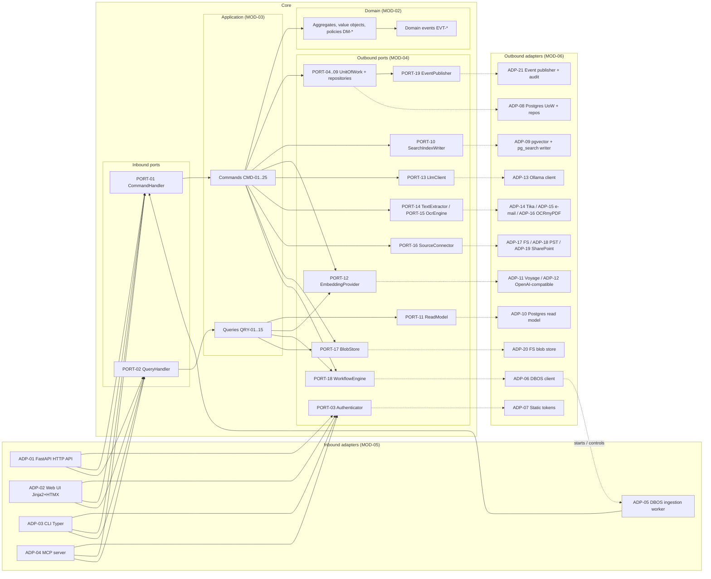
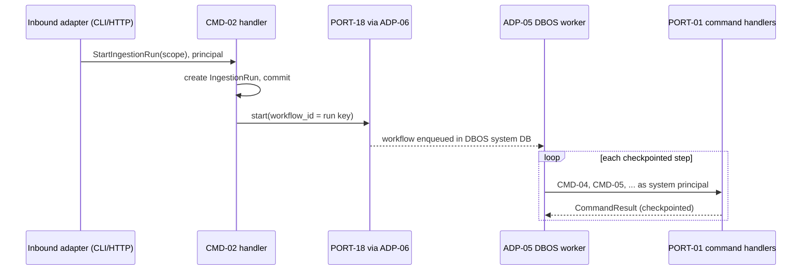
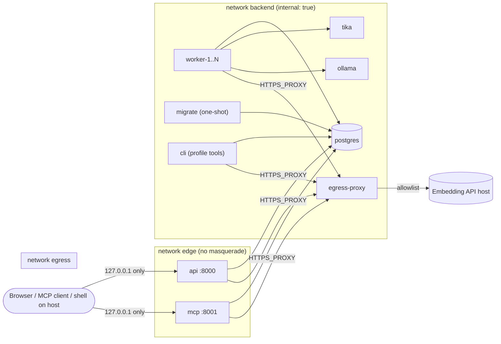

# Architecture overview

The architecture map of the PoC: the hexagon, its layers and rules ([ARCH-01](#arch-01) to [ARCH-08](#arch-08)), the local docker compose deployment ([DEP-01](#dep-01) to [DEP-08](#dep-08)), the source-code layout ([MOD-01](#mod-01) to [MOD-09](#mod-09)) and the cross-cutting concerns ([XC-01](#xc-01) to [XC-08](#xc-08)). Why the style and stack were chosen is in [ADR-01](decisions.md#adr-01) to [ADR-14](decisions.md#adr-14); ID and link rules are in [CONV-01](../README.md#conv-01) to [CONV-05](../README.md#conv-05).

## Architecture

<a id="arch-01"></a>
### ARCH-01 Hexagon map



- <a id="arch-01-1"></a>**ARCH-01.1** Solid arrows are calls and compile-time dependencies; dotted arrows are "implemented by". Every solid arrow points into the core or from the application to a port, never from the core to an adapter ([ARCH-03](#arch-03)).
- <a id="arch-01-2"></a>**ARCH-01.2** Node legend, left to right: inbound adapters [ADP-01](ports-adapters.md#adp-01), [ADP-02](ports-adapters.md#adp-02), [ADP-03](ports-adapters.md#adp-03), [ADP-04](ports-adapters.md#adp-04), [ADP-05](ports-adapters.md#adp-05); inbound ports [PORT-01](ports-adapters.md#port-01), [PORT-02](ports-adapters.md#port-02); commands from [CMD-01](application.md#cmd-01) and queries from [QRY-01](application.md#qry-01); domain items from [DM-01](domain.md#dm-01) and events from [EVT-01](domain.md#evt-01); outbound ports [PORT-03](ports-adapters.md#port-03) to [PORT-19](ports-adapters.md#port-19); outbound adapters [ADP-06](ports-adapters.md#adp-06) to [ADP-21](ports-adapters.md#adp-21).
- <a id="arch-01-3"></a>**ARCH-01.3** Authentication happens in the inbound adapter: it resolves the credential through [PORT-03](ports-adapters.md#port-03) and passes the resulting principal into every handler call. Handlers never read credentials.
- <a id="arch-01-4"></a>**ARCH-01.4** The DBOS worker appears twice by design: as an inbound adapter that drives commands ([ADP-05](ports-adapters.md#adp-05)) and, through [ADP-06](ports-adapters.md#adp-06), as the engine the application starts and controls ([ARCH-08](#arch-08)).
- <a id="arch-01-5"></a>**ARCH-01.5** Queries may call [PORT-12](ports-adapters.md#port-12) to embed the query text and [PORT-17](ports-adapters.md#port-17) to stream an original; both are side-effect free on the store.
- <a id="arch-01-6"></a>**ARCH-01.6** In-memory doubles ([ADP-22](ports-adapters.md#adp-22)) implement every outbound port and are omitted from the diagram.

Refs: [MOD-01](#mod-01), [PORT-01](ports-adapters.md#port-01), [PORT-02](ports-adapters.md#port-02), [ADP-01](ports-adapters.md#adp-01), [ADP-04](ports-adapters.md#adp-04), [ADP-05](ports-adapters.md#adp-05), [ADP-08](ports-adapters.md#adp-08), [ADP-11](ports-adapters.md#adp-11), [ADP-13](ports-adapters.md#adp-13), [MOD-05](#mod-05), [MOD-03](#mod-03), [MOD-02](#mod-02), [MOD-04](#mod-04), [PORT-04](ports-adapters.md#port-04), [PORT-10](ports-adapters.md#port-10), [PORT-11](ports-adapters.md#port-11), [PORT-13](ports-adapters.md#port-13), [PORT-14](ports-adapters.md#port-14), [PORT-15](ports-adapters.md#port-15), [PORT-16](ports-adapters.md#port-16), [PORT-18](ports-adapters.md#port-18), [MOD-06](#mod-06), [ADP-07](ports-adapters.md#adp-07), [ADP-09](ports-adapters.md#adp-09), [ADP-10](ports-adapters.md#adp-10), [ADP-12](ports-adapters.md#adp-12), [ADP-14](ports-adapters.md#adp-14), [ADP-15](ports-adapters.md#adp-15), [ADP-16](ports-adapters.md#adp-16), [ADP-17](ports-adapters.md#adp-17), [ADP-18](ports-adapters.md#adp-18), [ADP-19](ports-adapters.md#adp-19), [ADP-20](ports-adapters.md#adp-20)

<a id="arch-02"></a>
### ARCH-02 Layers and responsibilities

- <a id="arch-02-1"></a>**ARCH-02.1 Domain** ([MOD-02](#mod-02)). Contains entities, value objects, aggregates with their invariants, domain events and pure policies (assignment precedence, confidence banding, thread key normalisation). Plain Python 3.12 dataclasses and enums. No I/O, no clock or random calls (time and IDs are passed in), no framework types, no Pydantic.
- <a id="arch-02-2"></a>**ARCH-02.2 Application** ([MOD-03](#mod-03)). Contains command and query DTOs, their handlers, the enrichment prompt templates rendered by [CMD-11](application.md#cmd-11), and handler decorators (transaction, logging context). Orchestrates domain objects and outbound ports. Holds no SQL, HTTP, DBOS or MCP code.
- <a id="arch-02-3"></a>**ARCH-02.3 Ports** ([MOD-04](#mod-04)). `typing.Protocol` interfaces, the DTOs that cross outbound ports, the command and query base types `Command`, `Query`, `CommandResult` and `ExecutionContext` ([MOD-04.1](#mod-04-1)), and the typed error hierarchy of [XC-05](#xc-05). Concrete command and query DTOs live in the application ([MOD-03.1](#mod-03-1)). No implementations.
- <a id="arch-02-4"></a>**ARCH-02.4 Adapters** ([MOD-05](#mod-05), [MOD-06](#mod-06)). Inbound adapters translate a transport (HTTP, HTML form, CLI argument, MCP tool call, workflow step) into a command or query call. Outbound adapters implement one port each against one technology. Adapters hold no business rules: a decision that would differ between two adapters of the same port belongs in the application or domain.
- <a id="arch-02-5"></a>**ARCH-02.5 Bootstrap** ([MOD-07](#mod-07)). The only layer that knows every other layer: settings, adapter construction and wiring per process ([ARCH-07](#arch-07)).

Refs: [MOD-02](#mod-02), [MOD-03](#mod-03), [MOD-04](#mod-04), [MOD-05](#mod-05), [MOD-06](#mod-06), [MOD-07](#mod-07), [ADR-01](decisions.md#adr-01)

<a id="arch-03"></a>
### ARCH-03 Dependency rule and enforcement

- <a id="arch-03-1"></a>**ARCH-03.1** Allowed import direction: `bootstrap` → `adapters` → `application` → `ports` → `domain`. A layer may import any layer to its right and none to its left.
- <a id="arch-03-2"></a>**ARCH-03.2** `docstore.adapters.inbound` and `docstore.adapters.outbound` must not import each other; inbound adapters reach outbound behaviour only through application handlers. Sub-packages inside `adapters.outbound` are mutually independent.
- <a id="arch-03-3"></a>**ARCH-03.3** `docstore.domain` may import only the standard library. `docstore.application` and `docstore.ports` must not import `sqlalchemy`, `psycopg`, `fastapi`, `starlette`, `httpx`, `dbos`, `mcp`, `tika`, `extract_msg`, `pypff`, `msgraph` or `ocrmypdf`.
- <a id="arch-03-4"></a>**ARCH-03.4** DBOS imports are confined to `adapters.inbound.workflows` and `adapters.outbound.workflow` ([ARCH-08](#arch-08)).
- <a id="arch-03-5"></a>**ARCH-03.5** Enforcement: `.importlinter` declares one `layers` contract for [ARCH-03.1](#arch-03-1), an `independence` contract for [ARCH-03.2](#arch-03-2) and `forbidden` contracts for [ARCH-03.3](#arch-03-3) and [ARCH-03.4](#arch-03-4). `tests/architecture/test_import_contracts.py` runs `lint-imports` so that `pytest` fails on a violation ([MOD-09](#mod-09)). This is the check of [SC-14](../success-criteria.md#sc-14).

Refs: [ADR-01](decisions.md#adr-01), [MOD-09](#mod-09), [SC-14](../success-criteria.md#sc-14)

<a id="arch-04"></a>
### ARCH-04 Light command/query separation

- <a id="arch-04-1"></a>**ARCH-04.1 Command rule.** A command is named in the imperative (catalogue from [CMD-01](application.md#cmd-01)) and returns only IDs, status and counts, never read-model data. Shape and result rule: [CMD-26.1](application.md#cmd-26-1), [CMD-26.7](application.md#cmd-26-7).
- <a id="arch-04-2"></a>**ARCH-04.2 Command path.** Open a unit of work ([PORT-04](ports-adapters.md#port-04)), load one aggregate through its repository, call domain methods, save and commit ([ARCH-06](#arch-06)). Commands never call [PORT-11](ports-adapters.md#port-11).
- <a id="arch-04-3"></a>**ARCH-04.3 Query rule.** A query is named as a question (catalogue from [QRY-01](application.md#qry-01)) and reads only through [PORT-11](ports-adapters.md#port-11), which always takes the permission predicate of [XC-01](#xc-01). Shape: [QRY-16.1](application.md#qry-16-1).
- <a id="arch-04-4"></a>**ARCH-04.4 Query path.** Queries never load aggregates, never open a write unit of work and never emit domain events. The one write on the query path is the access audit row ([XC-08.3](#xc-08-3)).
- <a id="arch-04-5"></a>**ARCH-04.5 One database.** Commands and queries use the same Postgres database. Read optimisation comes from SQL views, denormalised filter columns on chunks and indexes ([MOD-08](#mod-08)), maintained in the command transaction. There is no projection, no sync lag and no second store; a query issued after a command commits sees its effect.
- <a id="arch-04-6"></a>**ARCH-04.6 Handler registry.** Inbound adapters obtain handlers from the bootstrap registry by DTO type through [PORT-01](ports-adapters.md#port-01) and [PORT-02](ports-adapters.md#port-02); they never instantiate handlers themselves.

Refs: [PORT-01](ports-adapters.md#port-01), [PORT-02](ports-adapters.md#port-02), [PORT-11](ports-adapters.md#port-11), [ADR-01](decisions.md#adr-01), [SCOPE-08](../README.md#scope-08)

<a id="arch-05"></a>
### ARCH-05 Domain events

- <a id="arch-05-1"></a>**ARCH-05.1** Aggregates append events to an internal `pending_events` list from inside their methods; events are frozen dataclasses with `event_id`, `occurred_at`, the aggregate ID and the actor. The catalogue starts at [EVT-01](domain.md#evt-01).
- <a id="arch-05-2"></a>**ARCH-05.2** On commit, the unit of work collects the pending events of every saved aggregate and hands them to [PORT-19](ports-adapters.md#port-19), which dispatches them synchronously in the same process after the commit succeeds. On rollback the events are discarded.
- <a id="arch-05-3"></a>**ARCH-05.3** Subscribers are the audit writer for worker events ([XC-08.2](#xc-08-2)) and in-process side-effect handlers, such as invalidating the cached taxonomy after a term change. A handler failure is logged with the event ID and does not undo the committed command.
- <a id="arch-05-4"></a>**ARCH-05.4** Events are not a persistence mechanism: state is never rebuilt from them, there is no broker, outbox or replay ([ADR-13](decisions.md#adr-13)). Work that must survive a crash is a workflow step ([ARCH-08](#arch-08)), not an event handler.

Refs: [EVT-01](domain.md#evt-01), [PORT-19](ports-adapters.md#port-19), [ADR-13](decisions.md#adr-13), [XC-08](#xc-08)

<a id="arch-06"></a>
### ARCH-06 Transactions and unit of work

- <a id="arch-06-1"></a>**ARCH-06.1** One command handler call is one database transaction (`READ COMMITTED`) that modifies at most one aggregate, except as listed in [CMD-26.3](application.md#cmd-26-3). Other effects on another aggregate are a separate command, issued by the next workflow step or by the caller.
- <a id="arch-06-2"></a>**ARCH-06.2** Concurrent writers are detected by an integer `version` column on each aggregate root (optimistic locking). A conflict raises a transient error ([XC-05](#xc-05)) and the step is retried.
- <a id="arch-06-3"></a>**ARCH-06.3** Commands that call slow external services ([CMD-07](application.md#cmd-07), [CMD-11](application.md#cmd-11), [CMD-14](application.md#cmd-14)) run in three phases: read inputs in a short transaction, call the external port with no transaction open, then write results in a second short transaction that first checks that the inputs are still current (same text hash and version stamps, [XC-06](#xc-06)). No database connection is held during an LLM, OCR or embedding call.
- <a id="arch-06-4"></a>**ARCH-06.4** Unique constraints on natural keys (source key, content sha256, chunk ordinal per document version) are the last line of idempotency; the step contract is in [ING-18](ingestion.md#ing-18).

Refs: [PORT-04](ports-adapters.md#port-04), [ING-18](ingestion.md#ing-18)

<a id="arch-07"></a>
### ARCH-07 Composition root and wiring

- <a id="arch-07-1"></a>**ARCH-07.1** `docstore.bootstrap.container.build(settings) -> Container` constructs each adapter once per process, binds it to its port and builds the handler registry. Plain functions, no DI framework.
- <a id="arch-07-2"></a>**ARCH-07.2** Profiles select bindings: `local` binds the real adapters of [MOD-06](#mod-06); `test` binds [ADP-22](ports-adapters.md#adp-22) fakes, optionally overridden per port by integration tests. The profile comes from `DOCSTORE_PROFILE` ([XC-04](#xc-04)).
- <a id="arch-07-3"></a>**ARCH-07.3** Each process has its own entrypoint module that calls `build` and starts its inbound adapter: `bootstrap.api` (api service, [DEP-03](#dep-03)), `bootstrap.mcp` ([DEP-04](#dep-04)), `bootstrap.worker` ([DEP-05](#dep-05)) and `bootstrap.cli`. A process wires only the inbound adapters it serves, but always the full set of outbound ports.
- <a id="arch-07-4"></a>**ARCH-07.4** Settings are validated at build time and the process refuses to start on invalid settings ([XC-04.4](#xc-04-4)).

Refs: [MOD-07](#mod-07), [XC-04](#xc-04), [ADP-22](ports-adapters.md#adp-22)

<a id="arch-08"></a>
### ARCH-08 Workflow engine placement



- <a id="arch-08-1"></a>**ARCH-08.1** Workflows and steps are defined in `adapters.inbound.workflows` ([ADP-05](ports-adapters.md#adp-05)). A step function does one thing: build a command DTO from its inputs, call the handler through [PORT-01](ports-adapters.md#port-01) and return the `CommandResult` for DBOS to checkpoint.
- <a id="arch-08-2"></a>**ARCH-08.2** Workflow code may decide only sequencing, fan-out, queue choice and retry settings. Every business decision (whether an item is a duplicate, which assignment wins, whether to OCR) is made inside a command handler and returned in its result.
- <a id="arch-08-3"></a>**ARCH-08.3** The application starts, pauses, resumes, cancels and inspects workflows only through [PORT-18](ports-adapters.md#port-18), implemented by [ADP-06](ports-adapters.md#adp-06), with deterministic workflow IDs.
- <a id="arch-08-4"></a>**ARCH-08.4** Workflow steps run commands as the system principal `svc-ingest`, which has no read access through [XC-01](#xc-01) and exists only for audit attribution.
- <a id="arch-08-5"></a>**ARCH-08.5** The workflow definitions, queues and recovery semantics are owned by [WF-01](ingestion.md#wf-01) to [WF-05](ingestion.md#wf-05).

Refs: [ADP-05](ports-adapters.md#adp-05), [ADP-06](ports-adapters.md#adp-06), [PORT-18](ports-adapters.md#port-18), [WF-01](ingestion.md#wf-01), [ADR-04](decisions.md#adr-04), [CMD-02](application.md#cmd-02), [CMD-04](application.md#cmd-04), [CMD-05](application.md#cmd-05)

## Deployment

<a id="dep-01"></a>
### DEP-01 Compose topology and egress



- <a id="dep-01-1"></a>**DEP-01.1** One `compose.yaml` at the repository root defines the stack ([MOD-01](#mod-01)). Images are pinned by tag and digest; the application image is built once and reused by api, mcp, cli and migrate, and the worker image extends it ([DEP-05](#dep-05)).
- <a id="dep-01-2"></a>**DEP-01.2** Network `backend` is `internal: true`: no container on it alone can reach outside the host. All services join it.
- <a id="dep-01-3"></a>**DEP-01.3** Network `edge` is a bridge with `com.docker.network.bridge.enable_ip_masquerade: "false"`; api and mcp join it only so their ports can be published to `127.0.0.1`. Without masquerading it gives no outbound route.
- <a id="dep-01-4"></a>**DEP-01.4** `egress-proxy` (Squid, pinned image) is the only service on network `egress`. Its allowlist contains exactly the configured embedding API host (default `api.voyageai.com`) on port 443, CONNECT only. api, mcp, worker and cli set `HTTPS_PROXY=http://egress-proxy:3128` and `NO_PROXY` for the internal service names. Proxy access logs are the evidence for [SC-14](../success-criteria.md#sc-14).
- <a id="dep-01-5"></a>**DEP-01.5** The SharePoint Graph connector ([ADP-19](ports-adapters.md#adp-19)) is disabled by default; the PoC uses its folder-export fallback. Enabling it adds `graph.microsoft.com` and `login.microsoftonline.com` to the allowlist as an explicit, logged configuration change, and the egress check then runs against the extended list.
- <a id="dep-01-6"></a>**DEP-01.6** `migrate` runs `alembic upgrade head` as the migrator role and exits; api, mcp, worker and cli start only after it completes (`depends_on: condition: service_completed_successfully`), and after postgres, tika and ollama report healthy.
- <a id="dep-01-7"></a>**DEP-01.7** Optional profiles: `tools` adds the `cli` service (`docker compose run --rm cli <command>`); `setup` adds `ollama-pull`, which downloads the models into the models volume over a separate network with direct egress and is run once before any data is loaded; the `setup` profile must be down before any source is registered ([CMD-01](application.md#cmd-01)); `observability` adds an OpenTelemetry collector and Jaeger on `backend` ([XC-03.5](#xc-03-5)); `vllm` swaps in a vLLM service for ollama ([DEP-07.4](#dep-07-4)).
- <a id="dep-01-8"></a>**DEP-01.8** Every long-running service has `restart: always` and a healthcheck; the effective data policy for this topology is [XC-02](#xc-02).

Refs: [DEP-02](#dep-02), [DEP-03](#dep-03), [DEP-04](#dep-04), [DEP-05](#dep-05), [DEP-06](#dep-06), [DEP-07](#dep-07), [XC-02](#xc-02), [SCOPE-01](../README.md#scope-01)

<a id="dep-02"></a>
### DEP-02 postgres service

- <a id="dep-02-1"></a>**DEP-02.1** Image `paradedb/paradedb`, a pinned PostgreSQL 17 tag, providing the `vector` (pgvector) and `pg_search` extensions. Port published only in the developer override file, on `127.0.0.1:5432`.
- <a id="dep-02-2"></a>**DEP-02.2** Two databases on one instance: `docstore` (application schema, [MOD-08](#mod-08)) and `docstore_dbos` (DBOS system database, [ADR-04](decisions.md#adr-04)).
- <a id="dep-02-3"></a>**DEP-02.3** Roles: `docstore_migrator` owns the schema and runs migrations; `docstore_app` is used by the command path ([PORT-04](ports-adapters.md#port-04)) with DML only; `docstore_reader` is used by the query path ([PORT-11](ports-adapters.md#port-11)) with `SELECT` plus `INSERT` on the audit table, is not a table owner and has no `BYPASSRLS`, so row-level security always applies to it ([XC-01.6](#xc-01-6)); `docstore_dbos` owns the DBOS system database.
- <a id="dep-02-4"></a>**DEP-02.4** Tuning via mounted `postgresql.conf` include, sized in [DEP-08](#dep-08): `shared_buffers`, `effective_cache_size`, `maintenance_work_mem` (raised for HNSW builds), `max_parallel_maintenance_workers`, `max_connections` (default 300; it must cover two worker pools of `db.POOL_SIZE` ([WF-04.7](ingestion.md#wf-04-7)), the api and mcp pools, and the DBOS system-database connections of each process).
- <a id="dep-02-5"></a>**DEP-02.5** Healthcheck `pg_isready`; data on volume `pgdata` ([DEP-08.1](#dep-08-1)).

Refs: [ADR-03](decisions.md#adr-03), [ADR-04](decisions.md#adr-04), [ADP-08](ports-adapters.md#adp-08)

<a id="dep-03"></a>
### DEP-03 api service

- <a id="dep-03-1"></a>**DEP-03.1** Application image, command `uvicorn docstore.bootstrap.api:app --host 0.0.0.0 --port 8000 --workers 2`. Serves the HTTP API under `/api/v1` ([ADP-01](ports-adapters.md#adp-01)) and the UI under `/` ([ADP-02](ports-adapters.md#adp-02)).
- <a id="dep-03-2"></a>**DEP-03.2** Published on `127.0.0.1:8000`; health endpoints `/healthz` (liveness) and `/readyz` (database reachable, migrations at head).
- <a id="dep-03-3"></a>**DEP-03.3** Needs egress through the proxy only to embed query text for search ([ARCH-01.5](#arch-01-5)).
- <a id="dep-03-4"></a>**DEP-03.4** Stateless; runs no workflows, but may start and control them through [PORT-18](ports-adapters.md#port-18) as a DBOS client.

Refs: [ADP-01](ports-adapters.md#adp-01), [ADP-02](ports-adapters.md#adp-02)

<a id="dep-04"></a>
### DEP-04 mcp service

- <a id="dep-04-1"></a>**DEP-04.1** Application image, command `python -m docstore.bootstrap.mcp`, serving Streamable HTTP at `/mcp` on port 8001, published on `127.0.0.1:8001`. Server behaviour is in [MCP-01](mcp.md#mcp-01).
- <a id="dep-04-2"></a>**DEP-04.2** A separate process from api so that agent traffic can be scaled, restarted and audited independently; being stateless, it can run several replicas behind the same port mapping in later work.
- <a id="dep-04-3"></a>**DEP-04.3** Same egress need and health endpoints as [DEP-03](#dep-03).

Refs: [ADP-04](ports-adapters.md#adp-04), [MCP-01](mcp.md#mcp-01)

<a id="dep-05"></a>
### DEP-05 worker service

- <a id="dep-05-1"></a>**DEP-05.1** Image `docstore-worker`: the application image plus `ocrmypdf`, `tesseract-ocr` with the language packs listed in `DOCSTORE_OCR__LANGUAGES` (default `eng`), `ghostscript`, `qpdf`, `pngquant`, `libpff` with its Python binding `pypff`, and `extract-msg`. Command `python -m docstore.bootstrap.worker`.
- <a id="dep-05-2"></a>**DEP-05.2** Replicas are declared as distinct services `worker-1` to `worker-N` from one YAML anchor rather than with `--scale`, so that each replica keeps a stable DBOS executor ID (`DOCSTORE_WORKER__EXECUTOR_ID`) across restarts. With `restart: always` a crashed replica recovers its own pending workflows ([ADR-04](decisions.md#adr-04), [WF-05](ingestion.md#wf-05)). The PoC default is N = 2.
- <a id="dep-05-3"></a>**DEP-05.3** Mounts: source folders and PST files read-only at `/sources`, the blob volume read-write at `/blobs`, OCR scratch on a `tmpfs` at `/tmp/ocr`.
- <a id="dep-05-4"></a>**DEP-05.4** Resource limits: `cpus` and `mem_limit` per replica from [DEP-08](#dep-08); per-queue concurrency is set in [WF-04](ingestion.md#wf-04), not by container limits.
- <a id="dep-05-5"></a>**DEP-05.5** Health: the worker writes a heartbeat row every 15 s; the healthcheck fails if the heartbeat is older than 60 s.

Refs: [ADP-05](ports-adapters.md#adp-05), [ADP-16](ports-adapters.md#adp-16), [WF-04](ingestion.md#wf-04)

<a id="dep-06"></a>
### DEP-06 tika service

- <a id="dep-06-1"></a>**DEP-06.1** Image `apache/tika`, pinned 3.x tag (the non-`full` variant: OCR is done only by [ADP-16](ports-adapters.md#adp-16), never inside Tika). Internal port 9998, not published.
- <a id="dep-06-2"></a>**DEP-06.2** Started with `-spawnChild` so that a parser crash or hang restarts the child JVM, not the server; `tika-config.xml` (in `deploy/tika/`) disables the Tesseract parser and sets the per-request task timeout. JVM heap is set via `JAVA_TOOL_OPTIONS` from [DEP-08](#dep-08).
- <a id="dep-06-3"></a>**DEP-06.3** Healthcheck `GET /tika`. No egress.

Refs: [ADP-14](ports-adapters.md#adp-14), [ADR-07](decisions.md#adr-07)

<a id="dep-07"></a>
### DEP-07 ollama service

- <a id="dep-07-1"></a>**DEP-07.1** Image `ollama/ollama`, pinned tag; OpenAI-compatible endpoint `http://ollama:11434/v1`, internal only. Model and runtime parameters are those of [LLM-01](ingestion.md#llm-01).
- <a id="dep-07-2"></a>**DEP-07.2** GPU through `deploy.resources.reservations.devices` (NVIDIA Container Toolkit). Without a GPU the same service runs on CPU with the fallback model of [ADR-05](decisions.md#adr-05), and throughput projections must be taken from that configuration.
- <a id="dep-07-3"></a>**DEP-07.3** `OLLAMA_NUM_PARALLEL` equals the llm queue cap of [WF-04](ingestion.md#wf-04), so the server never queues requests the workflow believes are running; `OLLAMA_KEEP_ALIVE=-1` keeps the model resident; models live on volume `ollama-models` and are pulled only by `ollama-pull` ([DEP-01.7](#dep-01-7)). No runtime egress.
- <a id="dep-07-4"></a>**DEP-07.4** Profile `vllm` replaces it with `vllm/vllm-openai` serving the same model family on the same `/v1` endpoint; only `DOCSTORE_LLM__BASE_URL` and `DOCSTORE_LLM__MODEL` change ([XC-04](#xc-04)). This is the main throughput lever in [DEP-08.6](#dep-08-6).

Refs: [ADP-13](ports-adapters.md#adp-13), [LLM-01](ingestion.md#llm-01), [ADR-05](decisions.md#adr-05)

<a id="dep-08"></a>
### DEP-08 Volumes, host sizing and scale path

- <a id="dep-08-1"></a>**DEP-08.1 Volumes.** `pgdata` (both databases), `blobs` (content-addressed originals and extracted text, [ADR-11](decisions.md#adr-11)), `ollama-models`, and a read-only bind mount of the sample sources. All named volumes sit on the encrypted host disk required by [XC-02.6](#xc-02-6).
- <a id="dep-08-2"></a>**DEP-08.2 Reference host.** Linux, 16 physical cores, 128 GB RAM, one NVIDIA GPU with 24 GB VRAM, 2 TB NVMe. It runs the sample corpus and the 10M-chunk synthetic load of [SC-07](../success-criteria.md#sc-07). A demo-only host (sample corpus, no scale test) needs 8 cores, 32 GB RAM and 500 GB disk, plus a GPU or the CPU fallback of [DEP-07.2](#dep-07-2).
- <a id="dep-08-3"></a>**DEP-08.3 Memory budget on the reference host.** postgres 64 GB (`shared_buffers` 16 GB, `effective_cache_size` 48 GB, `maintenance_work_mem` 16 GB during bulk HNSW builds), workers 2 × 6 GB, tika 4 GB heap, api and mcp 2 GB each, OS and page cache the rest. Ollama uses VRAM, not host RAM.
- <a id="dep-08-4"></a>**DEP-08.4 Storage projection for 100 GB** (about 2M documents and 10M chunks, [SCOPE-02](../README.md#scope-02)). These are design assumptions that [SC-07](../success-criteria.md#sc-07) replaces with measured ratios.

  | Component | Basis | Projected size |
  |---|---|---|
  | Vectors | 10M × `halfvec(1024)` ≈ 2.1 KB | ≈ 21 GB |
  | HNSW index | ≈ 1.3 × vector size | ≈ 27 GB |
  | Chunk text | 10M × ≈ 2 KB, TOAST-compressed | ≈ 12 GB |
  | BM25 index (pg_search) | ≈ 0.5 × raw chunk text | ≈ 10 GB |
  | Documents, assignments, enrichment, audit | 2M × ≈ 5 KB | ≈ 10 GB |
  | DBOS system database | pruned by retention ([XC-04](#xc-04)) | ≤ 20 GB |
  | Blobs | originals after exact dedup + extracted text | ≈ 110 GB |
  | Models | primary + fallback LLM | ≈ 15 GB |
  | **Total, with 2× headroom for WAL, bloat and rebuilds** | | **≈ 450 GB** |

- <a id="dep-08-5"></a>**DEP-08.5 RAM rule.** For the latency targets of [SC-07](../success-criteria.md#sc-07), the HNSW index plus the hot part of the BM25 index (≈ 35-40 GB at 10M chunks) must fit in `shared_buffers` plus OS page cache; that is why the reference host has 128 GB.
- <a id="dep-08-6"></a>**DEP-08.6 Ingestion time projection.** Duration ≈ max over stages of (stage work ÷ stage rate), because stages overlap on separate queues ([WF-04](ingestion.md#wf-04)). Assumed inputs, to be replaced by [SC-09](../success-criteria.md#sc-09) measurements:
  - Embedding: 10M chunks × ≈ 512 tokens ≈ 5 B tokens; at a 3M tokens/min provider limit ≈ 28 h. Cost is tokens × the provider's current price per million tokens.
  - OCR: assuming 10% of documents scanned at 5 pages each, ≈ 1M pages at ≈ 2 s per page per core, with the `ocr` cap of [WF-04.2](ingestion.md#wf-04-2) (4 concurrent jobs, one core each, [ADP-16.1](ports-adapters.md#adp-16-1)) ≈ 6 days. Raising the cap toward the free cores shortens this; OCR is not the bottleneck.
  - LLM enrichment: applied to canonical documents only (after exact dedup), assumed ≈ 1.2M documents. The 14-day target of [SC-09](../success-criteria.md#sc-09) needs a sustained ≥ 1 document/s. Ollama on one 24 GB GPU is expected below that, so enrichment is the bottleneck, and the [SC-09.6](../success-criteria.md#sc-09-6) projection uses the `vllm` profile ([DEP-07.4](#dep-07-4)).
- <a id="dep-08-7"></a>**DEP-08.7 Scale levers, in order of preference.** (1) vLLM continuous batching ([DEP-07.4](#dep-07-4)); (2) the smaller fallback model ([ADR-05](decisions.md#adr-05)); (3) a second GPU with a second LLM endpoint behind the same queue; (4) more worker replicas for OCR and extraction; (5) for the store, the vector levers of [ADR-12](decisions.md#adr-12) and the split-out threshold of [ADR-03](decisions.md#adr-03); (6) MinIO for blobs ([ADR-11](decisions.md#adr-11)).

Refs: [SCOPE-02](../README.md#scope-02), [SC-07](../success-criteria.md#sc-07), [ADR-11](decisions.md#adr-11), [ADR-12](decisions.md#adr-12)

## Modules

<a id="mod-01"></a>
### MOD-01 Repository layout

```text
documents_store/
├── pyproject.toml, uv.lock, .importlinter, compose.yaml, compose.dev.yaml
├── src/docstore/
│   ├── domain/            MOD-02
│   ├── application/       MOD-03
│   ├── ports/             MOD-04
│   ├── adapters/
│   │   ├── inbound/       MOD-05
│   │   └── outbound/      MOD-06
│   └── bootstrap/         MOD-07
├── migrations/            MOD-08
├── tests/                 MOD-09
├── eval/                  MOD-09
├── deploy/                Dockerfiles, env/*.env.example, squid/, tika/, postgres/
├── docs/                  this documentation
├── reports/, research_notes/   prior research, not built
```

- <a id="mod-01-1"></a>**MOD-01.1** One Python distribution `docstore` with a `src/` layout, managed by `uv`; Python 3.12 pinned in `.python-version` ([ADR-02](decisions.md#adr-02)).
- <a id="mod-01-2"></a>**MOD-01.2** Console script `docstore` points at the CLI entrypoint ([ARCH-07.3](#arch-07-3)).
- <a id="mod-01-3"></a>**MOD-01.3** `deploy/env/*.env` holds real settings and secrets and is git-ignored; only `*.env.example` files are committed ([XC-02.5](#xc-02-5)).

Refs: [MOD-02](#mod-02), [MOD-03](#mod-03), [MOD-04](#mod-04), [MOD-05](#mod-05), [MOD-06](#mod-06), [MOD-07](#mod-07), [MOD-08](#mod-08), [MOD-09](#mod-09), [ADR-02](decisions.md#adr-02)

<a id="mod-02"></a>
### MOD-02 docstore.domain

| Sub-package | Holds |
|---|---|
| <a id="mod-02-1"></a>MOD-02.1 `domain/shared` | typed IDs, the provenance value object of [DM-11](domain.md#dm-11), the base `DomainEvent` |
| <a id="mod-02-2"></a>MOD-02.2 `domain/documents` | [DM-03](domain.md#dm-03), [DM-04](domain.md#dm-04), [DM-05](domain.md#dm-05), [DM-06](domain.md#dm-06), [DM-12](domain.md#dm-12) |
| <a id="mod-02-3"></a>MOD-02.3 `domain/organisation` | [DM-07](domain.md#dm-07), [DM-08](domain.md#dm-08), [DM-09](domain.md#dm-09), [DM-10](domain.md#dm-10) |
| <a id="mod-02-4"></a>MOD-02.4 `domain/ingestion` | [DM-01](domain.md#dm-01), [DM-02](domain.md#dm-02), [DM-17](domain.md#dm-17) |
| <a id="mod-02-5"></a>MOD-02.5 `domain/review` | [DM-13](domain.md#dm-13) |
| <a id="mod-02-6"></a>MOD-02.6 `domain/classification` | [DM-14](domain.md#dm-14), [DM-15](domain.md#dm-15), taxonomy enums from [TAX-01](domain.md#tax-01) |
| <a id="mod-02-7"></a>MOD-02.7 `domain/access` | [DM-16](domain.md#dm-16) and the pure function that resolves a principal's allowed and walled matter sets ([XC-01.2](#xc-01-2)) |

Each sub-package has an `events.py` for its share of [EVT-01](domain.md#evt-01) onwards. Rules for what may live here are [ARCH-02.1](#arch-02-1).

Refs: [ARCH-02](#arch-02), [DM-03](domain.md#dm-03), [EVT-01](domain.md#evt-01)

<a id="mod-03"></a>
### MOD-03 docstore.application

- <a id="mod-03-1"></a>**MOD-03.1** Layout `application/commands/<area>/<command>.py` and `application/queries/<area>/<query>.py`; one file holds the DTO and its handler. File names are the snake_case DTO names (e.g. `start_ingestion_run.py` for [CMD-02](application.md#cmd-02)).
- <a id="mod-03-2"></a>**MOD-03.2** Areas: `sources`, `ingestion`, `documents`, `assignment`, `enrichment`, `review`, `reference`, `access`, `classification`, `search`, `audit`. The area of each command and query is listed with its definition in [application.md](application.md).
- <a id="mod-03-3"></a>**MOD-03.3** `application/shared/` holds the handler registry and decorators (base types are in [MOD-04.1](#mod-04-1)): `@transactional` (unit of work, [ARCH-06](#arch-06)) and `@log_context` ([XC-03.2](#xc-03-2)). Audit is written by the buses and the unit of work, not by a decorator ([XC-08](#xc-08)).
- <a id="mod-03-4"></a>**MOD-03.4** `application/enrichment/prompts/<version>/` holds the versioned prompt templates as package data; their contract and versioning are [LLM-02](ingestion.md#llm-02) and [LLM-04](ingestion.md#llm-04).

Refs: [ARCH-04](#arch-04), [CMD-01](application.md#cmd-01), [QRY-01](application.md#qry-01)

<a id="mod-04"></a>
### MOD-04 docstore.ports

| Module | Ports |
|---|---|
| <a id="mod-04-1"></a>MOD-04.1 `ports/inbound.py` | [PORT-01](ports-adapters.md#port-01), [PORT-02](ports-adapters.md#port-02), and the base types `Command`, `Query`, `CommandResult`, `ExecutionContext` ([CMD-26.1](application.md#cmd-26-1), [QRY-16.1](application.md#qry-16-1)) |
| <a id="mod-04-2"></a>MOD-04.2 `ports/auth.py` | [PORT-03](ports-adapters.md#port-03) |
| <a id="mod-04-3"></a>MOD-04.3 `ports/persistence.py` | [PORT-04](ports-adapters.md#port-04) to [PORT-09](ports-adapters.md#port-09) |
| <a id="mod-04-4"></a>MOD-04.4 `ports/search.py` | [PORT-10](ports-adapters.md#port-10), [PORT-11](ports-adapters.md#port-11) |
| <a id="mod-04-5"></a>MOD-04.5 `ports/ai.py` | [PORT-12](ports-adapters.md#port-12), [PORT-13](ports-adapters.md#port-13) |
| <a id="mod-04-6"></a>MOD-04.6 `ports/extraction.py` | [PORT-14](ports-adapters.md#port-14), [PORT-15](ports-adapters.md#port-15) |
| <a id="mod-04-7"></a>MOD-04.7 `ports/sources.py`, `ports/storage.py` | [PORT-16](ports-adapters.md#port-16), [PORT-17](ports-adapters.md#port-17) |
| <a id="mod-04-8"></a>MOD-04.8 `ports/workflow.py`, `ports/events.py` | [PORT-18](ports-adapters.md#port-18), [PORT-19](ports-adapters.md#port-19) |
| <a id="mod-04-9"></a>MOD-04.9 `ports/errors.py` | Typed error hierarchy of [XC-05.2](#xc-05-2) |

Refs: [PORT-01](ports-adapters.md#port-01), [PORT-12](ports-adapters.md#port-12)

<a id="mod-05"></a>
### MOD-05 docstore.adapters.inbound

| Sub-package | Adapter | Main contents |
|---|---|---|
| <a id="mod-05-1"></a>MOD-05.1 `http/` | [ADP-01](ports-adapters.md#adp-01) | one FastAPI router per application area, auth dependency, error → HTTP status mapping |
| <a id="mod-05-2"></a>MOD-05.2 `ui/` | [ADP-02](ports-adapters.md#adp-02) | Jinja2 templates, HTMX partials, routes for search, document, review queue, run progress |
| <a id="mod-05-3"></a>MOD-05.3 `cli/` | [ADP-03](ports-adapters.md#adp-03) | Typer app with groups `source`, `run`, `import`, `taxonomy`, `rules`, `review`, `reprocess`, `eval`, `demo` |
| <a id="mod-05-4"></a>MOD-05.4 `mcp/` | [ADP-04](ports-adapters.md#adp-04) | FastMCP server, tool and resource definitions, token → principal hook |
| <a id="mod-05-5"></a>MOD-05.5 `workflows/` | [ADP-05](ports-adapters.md#adp-05) | DBOS workflow and step functions, queue declarations, worker launch |

Refs: [ADP-01](ports-adapters.md#adp-01), [ADP-02](ports-adapters.md#adp-02), [ADP-03](ports-adapters.md#adp-03), [ADP-04](ports-adapters.md#adp-04), [ADP-05](ports-adapters.md#adp-05)

<a id="mod-06"></a>
### MOD-06 docstore.adapters.outbound

| Sub-package | Adapters |
|---|---|
| <a id="mod-06-1"></a>MOD-06.1 `postgres/` | [ADP-08](ports-adapters.md#adp-08): `tables.py` (SQLAlchemy Core `MetaData`), `uow.py`, `repositories/` |
| <a id="mod-06-2"></a>MOD-06.2 `search/` | [ADP-09](ports-adapters.md#adp-09), [ADP-10](ports-adapters.md#adp-10): `index_writer.py`, `read_model.py`, `sql/` (hybrid, facet and progress statements) |
| <a id="mod-06-3"></a>MOD-06.3 `embedding/` | [ADP-11](ports-adapters.md#adp-11), [ADP-12](ports-adapters.md#adp-12), shared `ratelimit.py` |
| <a id="mod-06-4"></a>MOD-06.4 `llm/` | [ADP-13](ports-adapters.md#adp-13) |
| <a id="mod-06-5"></a>MOD-06.5 `extraction/` | [ADP-14](ports-adapters.md#adp-14), [ADP-15](ports-adapters.md#adp-15), [ADP-16](ports-adapters.md#adp-16) |
| <a id="mod-06-6"></a>MOD-06.6 `connectors/` | [ADP-17](ports-adapters.md#adp-17), [ADP-18](ports-adapters.md#adp-18), [ADP-19](ports-adapters.md#adp-19) |
| <a id="mod-06-7"></a>MOD-06.7 `storage/` | [ADP-20](ports-adapters.md#adp-20) |
| <a id="mod-06-8"></a>MOD-06.8 `workflow/` | [ADP-06](ports-adapters.md#adp-06) |
| <a id="mod-06-9"></a>MOD-06.9 `events/` | [ADP-21](ports-adapters.md#adp-21) |
| <a id="mod-06-10"></a>MOD-06.10 `auth/` | [ADP-07](ports-adapters.md#adp-07) |
| <a id="mod-06-11"></a>MOD-06.11 `fakes/` | [ADP-22](ports-adapters.md#adp-22), importable only from tests and the `test` profile |

Refs: [ADP-06](ports-adapters.md#adp-06), [ADP-08](ports-adapters.md#adp-08), [ADP-11](ports-adapters.md#adp-11), [ADP-13](ports-adapters.md#adp-13), [ADP-14](ports-adapters.md#adp-14), [ADP-17](ports-adapters.md#adp-17), [ADP-20](ports-adapters.md#adp-20), [ADP-21](ports-adapters.md#adp-21)

<a id="mod-07"></a>
### MOD-07 docstore.bootstrap

- <a id="mod-07-1"></a>**MOD-07.1** `settings.py`: the typed `Settings` model of [XC-04](#xc-04).
- <a id="mod-07-2"></a>**MOD-07.2** `container.py`: `build(settings)` and the per-profile bindings of [ARCH-07](#arch-07).
- <a id="mod-07-3"></a>**MOD-07.3** `logging.py`: structlog configuration of [XC-03](#xc-03), applied first by every entrypoint.
- <a id="mod-07-4"></a>**MOD-07.4** Entrypoints `api.py`, `mcp.py`, `worker.py`, `cli.py` ([ARCH-07.3](#arch-07-3)).

Refs: [ARCH-07](#arch-07), [XC-04](#xc-04)

<a id="mod-08"></a>
### MOD-08 Migrations and SQL views

- <a id="mod-08-1"></a>**MOD-08.1** `migrations/` is an Alembic environment that uses the `MetaData` from [MOD-06.1](#mod-06-1); revisions are named `NNNN_<slug>.py` and are linear (no branches).
- <a id="mod-08-2"></a>**MOD-08.2** Extensions (`vector`, `pg_search`) and the HNSW and BM25 indexes are created in dedicated revisions with raw SQL, using index parameters from [ADR-12](decisions.md#adr-12). Index revisions use `CREATE INDEX CONCURRENTLY` outside a transaction.
- <a id="mod-08-3"></a>**MOD-08.3** Read-optimised views live as `migrations/sql/views/v_<name>.sql` and are applied with `CREATE OR REPLACE VIEW` from a revision. The list of views and their content belong to [ADP-10.5](ports-adapters.md#adp-10-5).
- <a id="mod-08-4"></a>**MOD-08.4** Row-level security policies live in `migrations/sql/rls/` ([XC-01.6](#xc-01-6)); grants for the roles of [DEP-02.3](#dep-02-3) live in `migrations/sql/grants.sql`.
- <a id="mod-08-5"></a>**MOD-08.5** A CLI command drops and rebuilds the HNSW index around a bulk load, as [ADR-12](decisions.md#adr-12) requires for large loads.

Refs: [ADP-08](ports-adapters.md#adp-08), [ADP-09](ports-adapters.md#adp-09), [ADP-10](ports-adapters.md#adp-10)

<a id="mod-09"></a>
### MOD-09 Tests and evaluation

| Path | Content | Strategy |
|---|---|---|
| <a id="mod-09-1"></a>MOD-09.1 `tests/unit/domain/` | aggregate, invariant and policy tests | [XC-07.1](#xc-07-1) |
| <a id="mod-09-2"></a>MOD-09.2 `tests/unit/application/` | handler tests against fakes | [XC-07.2](#xc-07-2) |
| <a id="mod-09-3"></a>MOD-09.3 `tests/contract/` | one suite per outbound port, parametrised over fake and real adapter | [XC-07.3](#xc-07-3) |
| <a id="mod-09-4"></a>MOD-09.4 `tests/integration/` | testcontainers stacks (paradedb, tika) | [XC-07.4](#xc-07-4) |
| <a id="mod-09-5"></a>MOD-09.5 `tests/architecture/` | import contracts | [ARCH-03.5](#arch-03-5) |
| <a id="mod-09-6"></a>MOD-09.6 `tests/security/walls/` | wall leak suite | [XC-07.6](#xc-07-6) |
| <a id="mod-09-7"></a>MOD-09.7 `tests/chaos/` | kill and restart scripts against the compose stack | [XC-07.7](#xc-07-7) |
| <a id="mod-09-8"></a>MOD-09.8 `eval/datasets/`, `eval/scripts/`, `eval/reports/` | gold sets, measurement scripts, dated result reports | [F-20](../features.md#f-20) |

Refs: [XC-07](#xc-07), [F-20](../features.md#f-20), [ARCH-03](#arch-03)

## Cross-cutting concerns

<a id="xc-01"></a>
### XC-01 Access control enforcement

- <a id="xc-01-1"></a>**XC-01.1 Principal.** Every query and command receives a `Principal` (ID, kind human or agent, groups) resolved by [PORT-03](ports-adapters.md#port-03) in the inbound adapter. There is no anonymous access and no ambient or global principal.
- <a id="xc-01-2"></a>**XC-01.2 Access keys.** Each document and each of its chunks carries a denormalised `access_keys text[]` in the format of [DM-16.7](domain.md#dm-16-7), derived from its accepted matter assignments ([DM-10](domain.md#dm-10)). The keys are part of the Document aggregate and change in the same transaction as the assignment ([ARCH-06](#arch-06)).
- <a id="xc-01-3"></a>**XC-01.3 Predicate.** Per request, the handler resolves from [DM-16](domain.md#dm-16) the principal's `allowed` key set and `walled` key set, evaluated for today; which keys enter each set is defined by [DM-16.7](domain.md#dm-16-7). Both sets are bound as `text[]` parameters and tested with array overlap on `access_keys` ([ADP-10.1](ports-adapters.md#adp-10-1)). Default is deny.
- <a id="xc-01-4"></a>**XC-01.4 Placement.** [ADP-10](ports-adapters.md#adp-10) applies the predicate in a CTE that both the BM25 leg and the vector leg read from, before ranking and `LIMIT`; facet counts, totals, thread views, find-similar and matter lists use the same CTE. The vector leg uses pgvector iterative index scans so that filtering does not under-fill the top-k. A GIN index on `access_keys` backs the overlap test.
- <a id="xc-01-5"></a>**XC-01.5 Not-found semantics.** A walled or ungranted item returns exactly what a nonexistent ID returns (HTTP 404, MCP not-found error, empty thread slot) and contributes nothing to counts, facets, snippets or "similar" results.
- <a id="xc-01-6"></a>**XC-01.6 RLS backstop.** Read-model connections use the `docstore_reader` role ([DEP-02.3](#dep-02-3)), and each read transaction runs `SET LOCAL docstore.allowed = ...` and `SET LOCAL docstore.walled = ...`. RLS policies on documents, chunks, threads and matters repeat the predicate for that role, and an unset variable matches nothing, so a read-model query that forgets the CTE returns nothing rather than leaking. The command path (`docstore_app`) is not subject to these policies because it must maintain every document, and it never returns document content to a principal ([ARCH-04.1](#arch-04-1)).
- <a id="xc-01-7"></a>**XC-01.7 Agents.** MCP calls use the same predicate for the principal behind the token; tool arguments can only narrow it ([MCP-02](mcp.md#mcp-02)).

Refs: [DM-16](domain.md#dm-16), [PORT-03](ports-adapters.md#port-03), [PORT-11](ports-adapters.md#port-11), [MCP-02](mcp.md#mcp-02), [ADR-09](decisions.md#adr-09)

<a id="xc-02"></a>
### XC-02 Data confidentiality and egress

- <a id="xc-02-1"></a>**XC-02.1 What leaves the machine.** Chunk text at ingest ([ING-13](ingestion.md#ing-13)) and query text at search ([QRY-01](application.md#qry-01)), sent over TLS only to the configured embedding host through the proxy of [DEP-01.4](#dep-01-4). Nothing else leaves: document text sent to the LLM stays on the `ollama` service, and logs, traces and metrics stay local.
- <a id="xc-02-2"></a>**XC-02.2 Data policy.** Only sample or explicitly consented data is loaded ([SCOPE-04](../README.md#scope-04)). [CMD-01](application.md#cmd-01) refuses a source without `consent_reference` ([DM-01.5](domain.md#dm-01-5)) on every channel; it is recorded in the audit entry of [CMD-26.10](application.md#cmd-26-10).
- <a id="xc-02-3"></a>**XC-02.3 Provider settings.** The embedding account is configured for zero data retention and no training use where the provider offers it; the provider, model and account settings in force are recorded with each evaluation result.
- <a id="xc-02-4"></a>**XC-02.4 Telemetry off.** Third-party telemetry is disabled in every image (`DO_NOT_TRACK=1`, library-specific opt-outs); the egress proxy would block it anyway, and blocked attempts are reviewed in the proxy log.
- <a id="xc-02-5"></a>**XC-02.5 Secrets.** The embedding API key, MCP and HTTP bearer tokens and database passwords come from `deploy/env/*.env` or Docker secrets files under `/run/secrets`, loaded as `SecretStr` ([XC-04](#xc-04)); never from the repository, never logged.
- <a id="xc-02-6"></a>**XC-02.6 At rest.** All volumes sit on full-disk-encrypted storage on the host. `docstore demo purge` removes the database, blobs and logs at the end of the PoC.
- <a id="xc-02-7"></a>**XC-02.7 Logs carry no content.** A structlog processor drops or hashes fields named `text`, `content`, `prompt`, `completion` and `snippet`; logs contain IDs, hashes, sizes and counts only. Query text is kept only in the audit log ([XC-08](#xc-08)).
- <a id="xc-02-8"></a>**XC-02.8 Untrusted content.** Document text is untrusted input to the LLM; the safeguards are [LLM-06](ingestion.md#llm-06).

Refs: [SCOPE-04](../README.md#scope-04), [ADR-05](decisions.md#adr-05), [ADR-06](decisions.md#adr-06), [DEP-01](#dep-01), [LLM-06](ingestion.md#llm-06)

<a id="xc-03"></a>
### XC-03 Observability

- <a id="xc-03-1"></a>**XC-03.1 Logs.** structlog renders one JSON object per line to stdout in every service, with `ts`, `level`, `service`, `event` and the context keys of [XC-03.2](#xc-03-2). Docker's `local` log driver keeps them with rotation.
- <a id="xc-03-2"></a>**XC-03.2 Correlation keys.** Bound through `contextvars` by the adapters and the `@log_context` decorator: `request_id`, `principal_id`, `run_id`, `workflow_id`, `step`, `source_item_id`, `document_id`. Every log line inside a workflow step carries at least `run_id`, `workflow_id` and `step`.
- <a id="xc-03-3"></a>**XC-03.3 Step and adapter metrics.** Each step logs `step_finished` with `duration_ms`, `outcome` and `error_class` ([XC-05](#xc-05)). The embedding and LLM adapters log per call `tokens_in`, `tokens_out`, `batch_size`, `latency_ms` and `http_status`, plus `rate_limited` events with `retry_after_s`. These lines are the raw data for [SC-09](../success-criteria.md#sc-09).
- <a id="xc-03-4"></a>**XC-03.4 Progress.** Run-level counters, throughput and ETA are maintained by [ING-16](ingestion.md#ing-16) and read by [QRY-10](application.md#qry-10), combined with DBOS workflow status through [PORT-18](ports-adapters.md#port-18); the UI polls it every 5 s via HTMX, and `docstore run watch` polls it in the terminal.
- <a id="xc-03-5"></a>**XC-03.5 Traces (optional).** With `DOCSTORE_OTEL__ENABLED=true`, OpenTelemetry instrumentation (FastAPI, psycopg, httpx) exports OTLP to the local collector of the `observability` profile ([DEP-01.7](#dep-01-7)); the exporter endpoint must be an internal service name. W3C `traceparent` is propagated from HTTP and MCP requests into handlers.
- <a id="xc-03-6"></a>**XC-03.6 Health.** `/healthz` and `/readyz` on api and mcp ([DEP-03.2](#dep-03-2)), the worker heartbeat ([DEP-05.5](#dep-05-5)) and compose healthchecks give a one-glance status via `docker compose ps`.

Refs: [ING-16](ingestion.md#ing-16), [QRY-10](application.md#qry-10), [F-05](../features.md#f-05)

<a id="xc-04"></a>
### XC-04 Configuration

- <a id="xc-04-1"></a>**XC-04.1** One `pydantic-settings` `Settings` model with nested groups, environment prefix `DOCSTORE_` and nested delimiter `__` (e.g. `DOCSTORE_LLM__BASE_URL`). Sources in order of precedence: environment, `deploy/env/<profile>.env`, `/run/secrets`, defaults.
- <a id="xc-04-2"></a>**XC-04.2** Setting groups and their owners:

  | Group | Example keys | Values owned by |
  |---|---|---|
  | `db` | `URL`, `DBOS_URL`, `POOL_SIZE` | [DEP-02](#dep-02) |
  | `blob` | `ROOT` | [ADR-11](decisions.md#adr-11) |
  | `tika`, `ocr` | `TIKA__URL`, `OCR__LANGUAGES`, `OCR__TIMEOUT_S` | [DEP-06](#dep-06), [DEP-05](#dep-05) |
  | `llm` | `BASE_URL`, `MODEL`, `TIMEOUT_S`, `PROMPT_VERSION` | [LLM-01](ingestion.md#llm-01), [LLM-04](ingestion.md#llm-04) |
  | `embedding` | `PROVIDER`, `MODEL`, `DIMENSION`, `API_KEY` (secret), `BASE_URL` | [ADR-06](decisions.md#adr-06) |
  | `queues` | `LLM_CONCURRENCY`, `OCR_CONCURRENCY`, `EMBED_REQUESTS_PER_MIN`, `EMBED_TOKENS_PER_MIN`, `ENQUEUE_BOUND` | [WF-04](ingestion.md#wf-04), [WF-01](ingestion.md#wf-01) |
  | `retry` | per error class attempts and backoff | [XC-05.1](#xc-05-1) |
  | `thresholds` | `AUTO_ACCEPT`, `REVIEW_FLOOR` | [TAX-04](domain.md#tax-04) |
  | `auth` | `TOKENS_FILE` (secret) | [ADP-07](ports-adapters.md#adp-07) |
  | `worker` | `EXECUTOR_ID`, `DBOS_RETENTION_DAYS` | [DEP-05.2](#dep-05-2), [ADR-04](decisions.md#adr-04) |
  | `otel` | `ENABLED`, `ENDPOINT` | [XC-03.5](#xc-03-5) |

- <a id="xc-04-3"></a>**XC-04.3** `DOCSTORE_PROFILE` selects `local` or `test` bindings ([ARCH-07.2](#arch-07-2)).
- <a id="xc-04-4"></a>**XC-04.4 Fail fast.** At startup the process refuses to start if a required key is missing, if `embedding.DIMENSION` differs from the dimension of the chunk vector column, if the OTel endpoint or LLM base URL is not an internal host, or if `thresholds` are not ordered.
- <a id="xc-04-5"></a>**XC-04.5** A hash of the effective non-secret settings is logged at startup and stored with every ingestion run, so results can be tied to configuration ([XC-06](#xc-06)).

Refs: [MOD-07](#mod-07), [WF-04](ingestion.md#wf-04), [TAX-04](domain.md#tax-04)

<a id="xc-05"></a>
### XC-05 Error classification and retry policy

- <a id="xc-05-1"></a>**XC-05.1 Classes.**

  | Class | Typical causes | Retry | Terminal action |
  |---|---|---|---|
  | `transient` | connection reset, timeout, HTTP 5xx, Tika child restart, Postgres serialization or deadlock, optimistic-lock conflict ([ARCH-06.2](#arch-06-2)) | up to 5 attempts, exponential backoff 2 s × 2ⁿ, cap 5 min, full jitter | after the last attempt, reclassified as `permanent` with reason `retries_exhausted` |
  | `rate_limited` | HTTP 429, provider quota errors | waits `Retry-After` when given, else backoff 5 s × 2ⁿ, cap 10 min; does not consume the transient attempt budget; gives up after 24 h | item stays pending; run shows a throttled state, never quarantined for this class |
  | `permanent` | unsupported or corrupt file, password-protected or DRM file, file above size limit, empty text after OCR | none | item quarantined with a reason code |
  | `poison` | the item crashed or hung its process (OOM kill, parser segfault, hard timeout) on 3 executions | none | item quarantined with reason `poison` |

- <a id="xc-05-2"></a>**XC-05.2 Typed errors.** `ports/errors.py` ([MOD-04.9](#mod-04-9)) defines `TransientError`, `RateLimitedError(retry_after_s)` and `PermanentError(reason_code)`. Adapters translate library and HTTP errors into these; unknown exceptions count as `transient`.
- <a id="xc-05-3"></a>**XC-05.3 Poison detection.** The attempt counter on the source item ([DM-02](domain.md#dm-02)) is incremented in a committed transaction before a heavy step starts and reset on success, so a crash that kills the process is still counted.
- <a id="xc-05-4"></a>**XC-05.4 Reason codes.** `unsupported_format`, `corrupt`, `encrypted`, `too_large`, `empty_text`, `ocr_failed`, `retries_exhausted`, `poison`. Exclusion is not an error: it is the stage status `excluded` ([DM-02.6](domain.md#dm-02-6)). They are the error classes that [SC-01](../success-criteria.md#sc-01) reconciles against and that [QRY-11](application.md#qry-11) reports.
- <a id="xc-05-5"></a>**XC-05.5** Where this policy is applied in the pipeline, and how a degradable step such as enrichment continues without quarantine, is defined in [ING-15](ingestion.md#ing-15) and [LLM-05](ingestion.md#llm-05).

Refs: [ING-15](ingestion.md#ing-15), [WF-05](ingestion.md#wf-05), [CMD-16](application.md#cmd-16)

<a id="xc-06"></a>
### XC-06 Versioning of derived data

- <a id="xc-06-1"></a>**XC-06.1 Version stamps.**

  | Stamp | Format example | Stamped on | Changing it makes stale |
  |---|---|---|---|
  | `parser_version` | `tika-3.x/docstore-extract-1` | extracted text | extraction and all later stages, subject to [XC-06.3](#xc-06-3) |
  | `ocr_version` | `ocrmypdf-16/tesseract-5/eng` | extracted text of OCRed documents | same as `parser_version` |
  | `ruleset_version` | RuleSet published number, e.g. `rules-7` | rule-based assignments | rule assignment and reconciliation |
  | `prompt_version` | `enrich-v3+sha256:…` | enrichment provenance | enrichment and reconciliation |
  | `llm_model` | model tag plus digest | enrichment provenance | enrichment and reconciliation |
  | `chunker_version` | `chunk-v1-512-64` | chunks | chunking, embedding, indexing |
  | `embedding_model` | `<provider>/<model>/<dim>`, e.g. `voyage/voyage-3.5/1024`; compared for equality | chunk vectors | embedding, indexing |
  | `pipeline_version` | hash of all stamps above | workflow ID of [WF-02](ingestion.md#wf-02), ingestion run | the item's pipeline workflow |

- <a id="xc-06-2"></a>**XC-06.2** Stamps are strings in columns next to the data they describe and inside [DM-11](domain.md#dm-11) provenance; they are produced by the adapter or component that did the work, never inferred later.
- <a id="xc-06-3"></a>**XC-06.3** Re-extraction that yields the same text sha256 does not make downstream stages stale.
- <a id="xc-06-4"></a>**XC-06.4** Human overrides ([CMD-17](application.md#cmd-17), [CMD-18](application.md#cmd-18)) carry no automated stamp and are never made stale by a version change.
- <a id="xc-06-5"></a>**XC-06.5** How staleness is detected and reprocessing scheduled is [ING-17](ingestion.md#ing-17); the reprocessing workflow is [WF-03](ingestion.md#wf-03).

Refs: [DM-11](domain.md#dm-11), [ING-17](ingestion.md#ing-17), [LLM-04](ingestion.md#llm-04), [ADR-12](decisions.md#adr-12)

<a id="xc-07"></a>
### XC-07 Testing strategy

- <a id="xc-07-1"></a>**XC-07.1 Domain unit tests.** Pure, fast, no fixtures beyond builders; `pytest-socket` disables network for the `unit` marker so I/O fails loudly. Target ≥ 90% branch coverage of `docstore.domain`.
- <a id="xc-07-2"></a>**XC-07.2 Application tests.** Handlers run against [ADP-22](ports-adapters.md#adp-22) fakes through the `test` profile, asserting results, saved aggregates, emitted events and audit rows.
- <a id="xc-07-3"></a>**XC-07.3 Port contract tests.** One abstract suite per outbound port defines the behaviour every adapter must have (idempotent put, cursor resumption, rate-limit signal, permission predicate applied). It runs against the fake always and against the real adapter under the `integration` marker, so fakes cannot drift from reality.
- <a id="xc-07-4"></a>**XC-07.4 Integration tests.** testcontainers start the same ParadeDB tag as [DEP-02](#dep-02) and the Tika image of [DEP-06](#dep-06), run migrations and exercise repositories, read model and extraction on fixture files of every in-scope format. The embedding API is replaced by a recorded-response stub; a `live` marker runs one smoke call against the real provider with synthetic text only. Real-LLM tests carry the `gpu` marker.
- <a id="xc-07-5"></a>**XC-07.5 Architecture tests.** [ARCH-03.5](#arch-03-5).
- <a id="xc-07-6"></a>**XC-07.6 Wall leak suite.** A generated fixture with granted, ungranted and walled matters for several principals. For every query, every MCP tool and every UI route, it asserts that no walled document ID, title, snippet, facet count, total or thread member appears, and that walled and nonexistent IDs return identical responses. It is the measurement for [SC-12](../success-criteria.md#sc-12).
- <a id="xc-07-7"></a>**XC-07.7 Chaos tests.** Scripts that kill workers and postgres at named pipeline points against the compose stack; they measure [SC-08](../success-criteria.md#sc-08).
- <a id="xc-07-8"></a>**XC-07.8 Default run.** `uv run pytest` runs `unit`, `contract` (fakes) and `architecture`; `-m integration`, `-m chaos`, `-m gpu` and `-m live` are opt-in.

Refs: [ADP-22](ports-adapters.md#adp-22), [MOD-09](#mod-09), [ARCH-03](#arch-03), [SC-12](../success-criteria.md#sc-12)

<a id="xc-08"></a>
### XC-08 Audit trail

- <a id="xc-08-1"></a>**XC-08.1 Table.** `audit_log`, append-only: `id bigserial`, `occurred_at`, `principal_id`, `acting_agent_id` (the agent principal of [DM-16.1](domain.md#dm-16-1), else null), `channel` (`http`, `ui`, `cli`, `mcp`, `worker`), `action` (command, query or event type), `target_type`, `target_ids uuid[]`, `matter_ids uuid[]` (matters of the targets and of the returned documents, for filtering by [QRY-14](application.md#qry-14)), `inputs jsonb` (redacted per [XC-02.7](#xc-02-7) except query text), `applied_filter jsonb` (hash and size of the allowed and walled sets), `result_ids uuid[]` (first 100), `result_count`, `outcome` (`ok`, `not_found`, `denied`, `error`), `request_id`, `run_id`.
- <a id="xc-08-2"></a>**XC-08.2 Command and event entries.** A command issued by a `human` or `agent` principal gets one entry, written in the command transaction by the unit of work ([PORT-04.5](ports-adapters.md#port-04-5)), so the entry commits or rolls back with the change. A command that fails is recorded by the command bus with its error outcome ([PORT-01.3](ports-adapters.md#port-01-3)). Domain events of worker commands are written by [ADP-21](ports-adapters.md#adp-21) after commit ([ARCH-05](#arch-05)); events from human or agent commands are not written again. The trade-off is [ADR-13](decisions.md#adr-13).
- <a id="xc-08-3"></a>**XC-08.3 Access entries.** The query bus ([PORT-02.4](ports-adapters.md#port-02-4)) writes one row per query call ([QRY-16.7](application.md#qry-16-7)) in its own short transaction before the response is returned. If that write fails, the call fails (fail-closed).
- <a id="xc-08-4"></a>**XC-08.4 Immutability.** `docstore_app` and `docstore_reader` have `INSERT` and `SELECT` on `audit_log` only; `UPDATE`, `DELETE` and `TRUNCATE` are not granted to any runtime role.
- <a id="xc-08-5"></a>**XC-08.5 Indexes.** B-tree on `(principal_id, occurred_at)` and `(occurred_at)`; GIN on `target_ids`, `matter_ids` and `result_ids` for "who saw this document" lookups via [QRY-14](application.md#qry-14).

Refs: [ADP-21](ports-adapters.md#adp-21), [EVT-01](domain.md#evt-01), [QRY-14](application.md#qry-14), [MCP-02](mcp.md#mcp-02), [ADR-13](decisions.md#adr-13)
