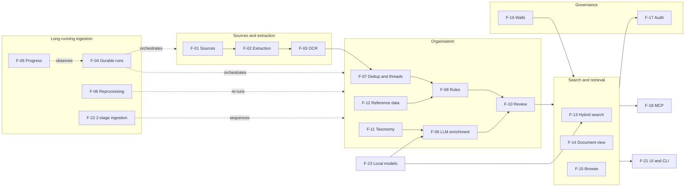

# Feature catalogue

This file owns the features (F-) of the PoC: what the system does, grouped by area. Each feature lists its sub-capabilities (F-NN.M), a priority, the success criteria it serves and the commands, queries, MCP items, workflow and pipeline steps that realise it. Behaviour, fields and rules are defined by the linked owners, not here ([CONV-04](README.md#conv-04)). Priority labels are defined in [CONV-06.12](README.md#conv-06-12) (must), [CONV-06.13](README.md#conv-06-13) (should) and [CONV-06.14](README.md#conv-06-14) (later); a feature's priority is that of its most important sub-capability. Scope boundaries are in [SCOPE-01](README.md#scope-01) to [SCOPE-08](README.md#scope-08).

## Catalogue

| Feature | Area | Priority | Serves |
|---|---|---|---|
| [F-01](#f-01) Source registration and discovery | Sources and extraction | must | [SC-01](success-criteria.md#sc-01) |
| [F-02](#f-02) Multi-format text extraction | Sources and extraction | must | [SC-01](success-criteria.md#sc-01) |
| [F-03](#f-03) OCR for scanned content | Sources and extraction | must | [SC-01](success-criteria.md#sc-01), [SC-02](success-criteria.md#sc-02) |
| [F-04](#f-04) Durable long-running ingestion | Long-running ingestion | must | [SC-07](success-criteria.md#sc-07), [SC-08](success-criteria.md#sc-08), [SC-09](success-criteria.md#sc-09) |
| [F-05](#f-05) Ingestion progress monitoring | Long-running ingestion | must | [SC-10](success-criteria.md#sc-10) |
| [F-06](#f-06) Version-aware reprocessing | Long-running ingestion | must | [SC-04](success-criteria.md#sc-04), [SC-08](success-criteria.md#sc-08) |
| [F-07](#f-07) Deduplication and e-mail threading | Organisation | must | [SC-13](success-criteria.md#sc-13) |
| [F-08](#f-08) Rules-based assignment | Organisation | must | [SC-03](success-criteria.md#sc-03) |
| [F-09](#f-09) Local-LLM enrichment (stage 2) | Organisation | must | [SC-04](success-criteria.md#sc-04) |
| [F-10](#f-10) Review queue and human override | Organisation | must | [SC-03](success-criteria.md#sc-03), [SC-04](success-criteria.md#sc-04) |
| [F-11](#f-11) Taxonomy management | Organisation | must | [SC-04](success-criteria.md#sc-04) |
| [F-12](#f-12) Reference data import | Organisation | must | [SC-03](success-criteria.md#sc-03) |
| [F-13](#f-13) Hybrid search | Search and retrieval | must | [SC-05](success-criteria.md#sc-05), [SC-06](success-criteria.md#sc-06), [SC-07](success-criteria.md#sc-07) |
| [F-14](#f-14) Document and thread view | Search and retrieval | must | [SC-13](success-criteria.md#sc-13), [SC-06](success-criteria.md#sc-06) |
| [F-15](#f-15) Faceted browse and matter overview | Search and retrieval | must | [SC-06](success-criteria.md#sc-06) |
| [F-16](#f-16) Permissions and ethical walls | Governance | must | [SC-12](success-criteria.md#sc-12) |
| [F-17](#f-17) Audit trail | Governance | must | [SC-12](success-criteria.md#sc-12) |
| [F-18](#f-18) MCP server for agents | Agent access | must | [SC-11](success-criteria.md#sc-11), [SC-12](success-criteria.md#sc-12) |
| [F-19](#f-19) Local one-command deployment | Platform and evaluation | must | [SC-07](success-criteria.md#sc-07), [SC-14](success-criteria.md#sc-14) |
| [F-20](#f-20) Evaluation harness | Platform and evaluation | must | [SC-03](success-criteria.md#sc-03), [SC-04](success-criteria.md#sc-04), [SC-05](success-criteria.md#sc-05), [SC-06](success-criteria.md#sc-06), [SC-07](success-criteria.md#sc-07), [SC-08](success-criteria.md#sc-08), [SC-12](success-criteria.md#sc-12), [SC-13](success-criteria.md#sc-13), [SC-15](success-criteria.md#sc-15), [SC-16](success-criteria.md#sc-16) |
| [F-21](#f-21) Minimal web UI and CLI | Platform and evaluation | must | [SC-03](success-criteria.md#sc-03), [SC-10](success-criteria.md#sc-10) |
| [F-22](#f-22) Two-stage ingestion | Long-running ingestion | must | [SC-16](success-criteria.md#sc-16), [SC-08](success-criteria.md#sc-08), [SC-09](success-criteria.md#sc-09), [SC-10](success-criteria.md#sc-10) |
| [F-23](#f-23) Local model serving | Platform and evaluation | must | [SC-14](success-criteria.md#sc-14), [SC-16](success-criteria.md#sc-16), [SC-09](success-criteria.md#sc-09) |

The map shows which features feed which: content flows from left to right, and governance applies to every read path. Nodes link to the feature.

## Sources and extraction

### F-01 Source registration and discovery

**Priority:** must. **Serves:** [SC-01](success-criteria.md#sc-01).

An operator registers the places content lives ([GL-01](README.md#gl-01)) and the system finds what is in them, incrementally and resumably.

- **F-01.1** `must` Register a local-drive source: a folder root on a mounted volume with include and exclude globs ([ADP-17](architecture/ports-adapters.md#adp-17)).
- **F-01.2** `must` Register a PST source: one or more PST files on a mounted volume; each message becomes a source item ([GL-02](README.md#gl-02)) with a stable key ([ADP-18](architecture/ports-adapters.md#adp-18)); attachments found inside messages and containers are added as further source items by [ING-04](architecture/ingestion.md#ing-04).
- **F-01.3** `must` Register a SharePoint source from a folder export that keeps site, library, path and column metadata ([ADP-19](architecture/ports-adapters.md#adp-19) fallback mode).
- **F-01.4** `later` Register a live SharePoint source over Microsoft Graph delta queries ([ADP-19](architecture/ports-adapters.md#adp-19)). It needs runtime egress to Microsoft hosts, which the zero-egress posture excludes ([SCOPE-04.7](README.md#scope-04-7)); the folder export of [F-01.3](#f-01-3) is the PoC path.
- **F-01.5** `must` Connectivity and readability are checked at registration; a failing source is rejected with the reason ([CMD-01](architecture/application.md#cmd-01)).
- **F-01.6** `must` Incremental discovery: each run continues from the source's saved cursor, picks up additions, edits and deletions, and skips items whose fingerprint is unchanged ([ING-01](architecture/ingestion.md#ing-01), measured by [SC-01.6](success-criteria.md#sc-01-6)).
- **F-01.7** `must` Discovery of a large source is paged and checkpointed, so a crash mid-discovery resumes at the last page, not at the start ([CMD-04](architecture/application.md#cmd-04), [WF-01](architecture/ingestion.md#wf-01)).
- **F-01.8** `later` Further connectors (live Exchange mailboxes, a DMS such as iManage) plug in behind [PORT-16](architecture/ports-adapters.md#port-16) without application changes.

Realised by: [CMD-01](architecture/application.md#cmd-01), [CMD-04](architecture/application.md#cmd-04), [ING-01](architecture/ingestion.md#ing-01), [ING-04](architecture/ingestion.md#ing-04), [WF-01](architecture/ingestion.md#wf-01).
Refs: [PORT-16](architecture/ports-adapters.md#port-16), [DM-01](architecture/domain.md#dm-01), [SCOPE-03](README.md#scope-03).

### F-02 Multi-format text extraction

**Priority:** must. **Serves:** [SC-01](success-criteria.md#sc-01).

Every in-scope format ([SCOPE-03](README.md#scope-03)) yields searchable text and its native metadata, including content nested inside e-mails and containers.

- **F-02.1** `must` E-mail: EML, MSG and PST messages yield the e-mail header field group of [DM-03](architecture/domain.md#dm-03) and a text body (HTML bodies converted to text) ([ADP-15](architecture/ports-adapters.md#adp-15), [ADP-18](architecture/ports-adapters.md#adp-18)).
- **F-02.2** `must` Office: OOXML (docx, xlsx, pptx), legacy binary (doc, xls, ppt) and RTF yield text and document properties ([ADP-14](architecture/ports-adapters.md#adp-14)).
- **F-02.3** `must` PDF: the text layer of born-digital PDFs is extracted; PDFs without a usable layer go to [F-03](#f-03).
- **F-02.4** `must` Attachments and embedded files, including attached e-mails nested two levels deep, become child documents in the parent's family ([GL-04](README.md#gl-04); [CMD-06](architecture/application.md#cmd-06), [ING-04](architecture/ingestion.md#ing-04); measured by [SC-01.4](success-criteria.md#sc-01-4)).
- **F-02.5** `must` Native metadata (author, created and modified dates, title) is captured where the source has it (measured by [SC-01.5](success-criteria.md#sc-01-5)).
- **F-02.6** `must` Corrupt, encrypted, zero-byte and unsupported inputs are quarantined with an error class from [XC-05](architecture/overview.md#xc-05) and never dropped silently ([ING-15](architecture/ingestion.md#ing-15); gates [SC-01.2](success-criteria.md#sc-01-2), [SC-01.3](success-criteria.md#sc-01-3)).
- **F-02.7** `should` ZIP archive members are expanded like attachments ([CMD-06](architecture/application.md#cmd-06)).
- **F-02.8** `later` Calendar items, contacts and Teams chats.

Realised by: [CMD-06](architecture/application.md#cmd-06), [CMD-07](architecture/application.md#cmd-07), [ING-04](architecture/ingestion.md#ing-04), [ING-05](architecture/ingestion.md#ing-05).
Refs: [PORT-14](architecture/ports-adapters.md#port-14), [ADR-07](architecture/decisions.md#adr-07).

### F-03 OCR for scanned content

**Priority:** must. **Serves:** [SC-01](success-criteria.md#sc-01), [SC-02](success-criteria.md#sc-02).

Scanned PDFs and images become searchable without paying OCR cost on documents that already have text.

- **F-03.1** `must` Detect a missing or unusable text layer and OCR only those documents, and only the image pages of mixed PDFs ([ING-06](architecture/ingestion.md#ing-06); measured by [SC-02.3](success-criteria.md#sc-02-3), [SC-02.4](success-criteria.md#sc-02-4)).
- **F-03.2** `must` Scanned PDFs and image files (TIFF, PNG, JPEG) produce searchable text stamped with the OCR engine version ([CMD-07](architecture/application.md#cmd-07), [XC-06](architecture/overview.md#xc-06)).
- **F-03.3** `must` OCR languages are configurable per deployment ([XC-04](architecture/overview.md#xc-04)).
- **F-03.4** `must` OCR runs on its own capped queue so it cannot starve other stages ([WF-04](architecture/ingestion.md#wf-04)).
- **F-03.5** `should` Page-level OCR confidence ([PORT-15](architecture/ports-adapters.md#port-15)) is kept, and documents below a configured confidence appear in the run's failure list as low-quality.
- **F-03.6** `later` Handwriting recognition and layout-aware OCR of tables.

Realised by: [CMD-07](architecture/application.md#cmd-07), [ING-06](architecture/ingestion.md#ing-06).
Refs: [PORT-15](architecture/ports-adapters.md#port-15), [ADR-07](architecture/decisions.md#adr-07).

## Long-running ingestion

### F-04 Durable long-running ingestion

**Priority:** must. **Serves:** [SC-07](success-criteria.md#sc-07), [SC-08](success-criteria.md#sc-08), [SC-09](success-criteria.md#sc-09).

An operator starts an ingestion run ([GL-18](README.md#gl-18)) over a source scope that may take days, and the run survives crashes, restarts and model-endpoint back-pressure without duplicate work.

- **F-04.1** `must` Start a run over a whole source or a sub-scope (folder, PST file, SharePoint library) from the CLI, API or UI; starting the same run key twice starts it once ([CMD-02](architecture/application.md#cmd-02), [WF-01](architecture/ingestion.md#wf-01)).
- **F-04.2** `must` Every pipeline step is checkpointed; after a worker or database crash the run resumes automatically with no duplicate documents or chunks ([WF-02](architecture/ingestion.md#wf-02), [ING-18](architecture/ingestion.md#ing-18), [WF-05](architecture/ingestion.md#wf-05); gates [SC-08.1](success-criteria.md#sc-08-1), [SC-08.2](success-criteria.md#sc-08-2), [SC-08.3](success-criteria.md#sc-08-3)).
- **F-04.3** `must` Re-running a completed run is a no-op (gates [SC-08.5](success-criteria.md#sc-08-5)).
- **F-04.4** `must` Pause, resume and cancel a run; in-flight steps finish or are abandoned per [WF-05](architecture/ingestion.md#wf-05) ([CMD-03](architecture/application.md#cmd-03); measured by [SC-08.6](success-criteria.md#sc-08-6)).
- **F-04.5** `must` Failed steps retry with backoff by error class, and poison items are quarantined without blocking the run ([ING-15](architecture/ingestion.md#ing-15), [XC-05](architecture/overview.md#xc-05), [CMD-16](architecture/application.md#cmd-16)).
- **F-04.6** **Retired:** there is no external embedding API or rate limit. Replaced by [F-04.11](#f-04-11).
- **F-04.7** `must` Concurrency of local-LLM, local-embedding and OCR work never exceeds its configured cap ([WF-04](architecture/ingestion.md#wf-04); gates [SC-09.3](success-criteria.md#sc-09-3)).
- **F-04.8** `must` Throughput scales by adding worker replicas, with no coordination beyond the database ([DEP-05](architecture/overview.md#dep-05)).
- **F-04.9** `should` Re-queue the quarantined items of a run after the cause is fixed, without re-running the rest ([CMD-25](architecture/application.md#cmd-25)).
- **F-04.10** `later` Scheduled incremental runs (for example nightly) per source.
- **F-04.11** `must` Model-endpoint back-pressure: when a local model endpoint is saturated, warming up or restarting, steps wait as `backpressure` without quarantine or attempt-budget use ([ING-15.3](architecture/ingestion.md#ing-15-3), [ING-15.4](architecture/ingestion.md#ing-15-4); gates [SC-09.1](success-criteria.md#sc-09-1)).

Realised by: [CMD-02](architecture/application.md#cmd-02), [CMD-03](architecture/application.md#cmd-03), [CMD-16](architecture/application.md#cmd-16), [CMD-25](architecture/application.md#cmd-25), [CMD-27](architecture/application.md#cmd-27), [WF-01](architecture/ingestion.md#wf-01), [WF-02](architecture/ingestion.md#wf-02), [WF-04](architecture/ingestion.md#wf-04), [WF-05](architecture/ingestion.md#wf-05), [WF-06](architecture/ingestion.md#wf-06), [WF-07](architecture/ingestion.md#wf-07), [ING-15](architecture/ingestion.md#ing-15), [ING-18](architecture/ingestion.md#ing-18).
Refs: [ADR-04](architecture/decisions.md#adr-04), [DM-17](architecture/domain.md#dm-17).

### F-05 Ingestion progress monitoring

**Priority:** must. **Serves:** [SC-10](success-criteria.md#sc-10).

Operators see how far a run is, how fast it goes, when it will finish and what failed.

- **F-05.1** `must` Run state and the per-stage counters of [ING-16](architecture/ingestion.md#ing-16) ([QRY-10](architecture/application.md#qry-10)).
- **F-05.2** `must` Throughput per stage group and an ETA, with stage-2 backlog and lag ([QRY-10](architecture/application.md#qry-10), [ING-16.7](architecture/ingestion.md#ing-16-7); measured by [SC-10.3](success-criteria.md#sc-10-3)).
- **F-05.3** `must` Failure list per run with error class, attempts and last error, filterable by stage and class ([QRY-11](architecture/application.md#qry-11); measured by [SC-10.4](success-criteria.md#sc-10-4)).
- **F-05.4** `must` The same numbers on the UI run page, the CLI status command and the HTTP API, at most 10 s stale ([F-21](#f-21); measured by [SC-10.1](success-criteria.md#sc-10-1), [SC-10.2](success-criteria.md#sc-10-2)).
- **F-05.5** `must` Logs correlated by run, workflow and document ID, so one document's history can be followed across services ([XC-03](architecture/overview.md#xc-03); measured by [SC-10.5](success-criteria.md#sc-10-5)).
- **F-05.6** `later` OpenTelemetry traces and metrics exported to an on-premises backend (no egress, [XC-03.5](architecture/overview.md#xc-03-5)).

Realised by: [QRY-10](architecture/application.md#qry-10), [QRY-11](architecture/application.md#qry-11), [ING-16](architecture/ingestion.md#ing-16).
Refs: [XC-03](architecture/overview.md#xc-03), [DM-17](architecture/domain.md#dm-17).

### F-06 Version-aware reprocessing

**Priority:** must. **Serves:** [SC-04](success-criteria.md#sc-04), [SC-08](success-criteria.md#sc-08).

When a parser, OCR setting, rule set, prompt, LLM or embedding model changes, only the affected stages of the affected documents are redone, and human decisions stay.

- **F-06.1** `must` Derived data carries the version stamps of [XC-06](architecture/overview.md#xc-06), so stale documents can be selected per stage.
- **F-06.2** `must` Request reprocessing by scope (source, matter, run, document list) and/or by stale version, choosing the stages to redo: extract, OCR, enrich, assign, chunk and embed ([CMD-25](architecture/application.md#cmd-25), [WF-03](architecture/ingestion.md#wf-03)); stage-2 stages are re-run as their own enrich run ([F-22.5](#f-22-5)).
- **F-06.3** `must` Downstream stages follow automatically (new text leads to re-chunking and re-embedding), and stages whose inputs did not change are skipped, so no GPU time is spent on unchanged chunks or unchanged enrichment inputs ([ING-17](architecture/ingestion.md#ing-17)).
- **F-06.4** `must` Human overrides of assignments and enrichment fields survive reprocessing ([F-10](#f-10); gates [SC-04.7](success-criteria.md#sc-04-7)).
- **F-06.5** `must` A reprocessing request is itself a durable run with progress, pause and cancel ([F-04](#f-04), [F-05](#f-05); measured by [SC-08.8](success-criteria.md#sc-08-8)).
- **F-06.6** `should` Dry run that reports, before starting, the number of affected documents and the estimated LLM calls, embedding tokens and GPU-hours per stage ([CMD-25.2](architecture/application.md#cmd-25-2)).
- **F-06.7** `later` Embedding-model migration with both vector versions kept until cut-over ([ADR-12](architecture/decisions.md#adr-12)).

Realised by: [CMD-25](architecture/application.md#cmd-25), [CMD-28](architecture/application.md#cmd-28), [WF-03](architecture/ingestion.md#wf-03), [ING-17](architecture/ingestion.md#ing-17).
Refs: [XC-06](architecture/overview.md#xc-06).

### F-22 Two-stage ingestion

**Priority:** must. **Serves:** [SC-16](success-criteria.md#sc-16), [SC-08](success-criteria.md#sc-08), [SC-09](success-criteria.md#sc-09), [SC-10](success-criteria.md#sc-10).

Documents become searchable through a deterministic stage 1 ([GL-21](README.md#gl-21)); LLM enrichment follows as an independently controlled stage 2 ([GL-22](README.md#gl-22), [ADR-17](architecture/decisions.md#adr-17)).

- **F-22.1** `must` Stage 1 makes a document searchable (keyword, vector, rule-derived metadata, ACL) without any LLM call ([WF-02](architecture/ingestion.md#wf-02), [ING-21](architecture/ingestion.md#ing-21); gates [SC-16.1](success-criteria.md#sc-16-1)).
- **F-22.2** `must` Stage-1 completion durably hands the document to stage 2 ([ING-14.4](architecture/ingestion.md#ing-14-4)).
- **F-22.3** `must` A run can be stage-1-only (`enrich_mode=none`), and stage 2 can be started later over waiting documents ([CMD-02](architecture/application.md#cmd-02), [CMD-25](architecture/application.md#cmd-25)).
- **F-22.4** `must` Stage 2 is paused, resumed, throttled and cancelled independently of stage 1, and its in-flight work is bounded by the admission window ([CMD-03](architecture/application.md#cmd-03), [WF-05.10](architecture/ingestion.md#wf-05-10), [WF-06.3](architecture/ingestion.md#wf-06-3); measured by [SC-16.3](success-criteria.md#sc-16-3) and [SC-09.4](success-criteria.md#sc-09-4)).
- **F-22.5** `must` Stage 2 re-runs on its own for a new prompt or LLM version, without re-chunking, re-embedding or touching stage 1 ([ING-17](architecture/ingestion.md#ing-17), [WF-06](architecture/ingestion.md#wf-06); gates [SC-16.2](success-criteria.md#sc-16-2)).
- **F-22.6** `must` Progress shows stage-2 backlog and lag separately ([QRY-10](architecture/application.md#qry-10), [ING-16.7](architecture/ingestion.md#ing-16-7)).
- **F-22.7** `must` GPU sharing gives query and stage-1 embedding priority over stage-2 LLM work ([WF-04.9](architecture/ingestion.md#wf-04-9); measured by [SC-16.6](success-criteria.md#sc-16-6)).
- **F-22.8** `later` Prioritised stage 2 (by matter, recency or document type).
- **F-22.9** `must` Per-stage throughput (stage-1 chunks/s, stage-2 documents/s) is measured on the reference host and projected to 100 GB per stage ([ING-16.4](architecture/ingestion.md#ing-16-4), [DEP-08.6](architecture/overview.md#dep-08-6); gates [SC-09.5](success-criteria.md#sc-09-5), [SC-09.6](success-criteria.md#sc-09-6)).

Realised by: [CMD-02](architecture/application.md#cmd-02), [CMD-03](architecture/application.md#cmd-03), [CMD-15](architecture/application.md#cmd-15), [CMD-25](architecture/application.md#cmd-25), [CMD-28](architecture/application.md#cmd-28), [WF-02](architecture/ingestion.md#wf-02), [WF-06](architecture/ingestion.md#wf-06), [WF-07](architecture/ingestion.md#wf-07), [ING-14](architecture/ingestion.md#ing-14), [ING-19](architecture/ingestion.md#ing-19), [ING-20](architecture/ingestion.md#ing-20), [ING-21](architecture/ingestion.md#ing-21).
Refs: [ADR-17](architecture/decisions.md#adr-17), [DM-17](architecture/domain.md#dm-17).

## Organisation

### F-07 Deduplication and e-mail threading

**Priority:** must. **Serves:** [SC-13](success-criteria.md#sc-13).

The same content stored many times is processed and shown once, and e-mail is organised into families and conversations.

- **F-07.1** `must` Byte-identical files collapse onto one canonical document that keeps every source location ([GL-20](README.md#gl-20); [ING-03](architecture/ingestion.md#ing-03), [CMD-05](architecture/application.md#cmd-05); gates [SC-13.1](success-criteria.md#sc-13-1)).
- **F-07.2** `must` The same e-mail found in several mailboxes, PSTs or as EML/MSG copies collapses by e-mail identity ([ING-03](architecture/ingestion.md#ing-03)).
- **F-07.3** `must` Exact duplicates cause no LLM or embedding calls after the canonical copy (measured by [SC-13.4](success-criteria.md#sc-13-4)).
- **F-07.4** `must` Near duplicates (drafts, re-saved versions, scans of the same paper) are grouped with a canonical member ([CMD-09](architecture/application.md#cmd-09), [ING-08](architecture/ingestion.md#ing-08); measured by [SC-13.2](success-criteria.md#sc-13-2)).
- **F-07.5** `must` E-mails are linked to their attachments as a family ([GL-04](README.md#gl-04)) and to a reconstructed thread ([GL-05](README.md#gl-05); [CMD-08](architecture/application.md#cmd-08), [ING-07](architecture/ingestion.md#ing-07); measured by [SC-13.3](success-criteria.md#sc-13-3)).
- **F-07.6** `must` Search results show one member per exact duplicate set ([F-13](#f-13); measured by [SC-05.5](success-criteria.md#sc-05-5)).
- **F-07.7** `later` Inclusive-message detection that suppresses e-mails fully quoted in a later reply.

Realised by: [CMD-05](architecture/application.md#cmd-05), [CMD-08](architecture/application.md#cmd-08), [CMD-09](architecture/application.md#cmd-09), [ING-03](architecture/ingestion.md#ing-03), [ING-07](architecture/ingestion.md#ing-07), [ING-08](architecture/ingestion.md#ing-08), [QRY-04](architecture/application.md#qry-04).
Refs: [DM-04](architecture/domain.md#dm-04), [DM-06](architecture/domain.md#dm-06).

### F-08 Rules-based assignment

**Priority:** must. **Serves:** [SC-03](success-criteria.md#sc-03).

Documents are assigned to clients, matters, handlers and case types ([GL-12](README.md#gl-12)) by deterministic, versioned rules first; the LLM only suggests ([ADR-08](architecture/decisions.md#adr-08)).

- **F-08.1** `must` Rules of each kind in [DM-15](architecture/domain.md#dm-15) are authored in a file kept in the repository, validated and published as an immutable version from the CLI ([CMD-24](architecture/application.md#cmd-24)).
- **F-08.2** `must` Each document receives client, matter, handler and case type assignments from the published rule set ([CMD-10](architecture/application.md#cmd-10), [ING-09](architecture/ingestion.md#ing-09)).
- **F-08.3** `must` Attachments inherit their family parent's assignment and replies inherit their thread's, unless a stronger signal disagrees ([CMD-10](architecture/application.md#cmd-10); measured by [SC-03.6](success-criteria.md#sc-03-6)).
- **F-08.4** `must` Every assignment records which rule and rule-set version produced it ([GL-16](README.md#gl-16)).
- **F-08.5** `must` Rule and LLM signals are reconciled under the confidence bands of [TAX-04](architecture/domain.md#tax-04): confident assignments are accepted, others go to review. Reconciliation runs in both stages ([DM-10.6](architecture/domain.md#dm-10-6), [CMD-12](architecture/application.md#cmd-12), [ING-11](architecture/ingestion.md#ing-11), [ING-19](architecture/ingestion.md#ing-19); gates [SC-03.4](success-criteria.md#sc-03-4)).
- **F-08.6** `should` Dry run of a draft rule set against indexed documents, reporting how many assignments would change.
- **F-08.7** `should` Publishing a rule-set version triggers re-assignment of affected documents through [F-06](#f-06).
- **F-08.8** `later` Rules learned from review decisions (suggested rules from frequent corrections).

Realised by: [CMD-10](architecture/application.md#cmd-10), [CMD-12](architecture/application.md#cmd-12), [CMD-24](architecture/application.md#cmd-24), [ING-09](architecture/ingestion.md#ing-09), [ING-11](architecture/ingestion.md#ing-11), [ING-19](architecture/ingestion.md#ing-19).
Refs: [ADR-08](architecture/decisions.md#adr-08), [DM-10](architecture/domain.md#dm-10).

### F-09 Local-LLM enrichment (stage 2)

**Priority:** must. **Serves:** [SC-04](success-criteria.md#sc-04).

In stage 2 ([GL-22](README.md#gl-22)), after the document is already searchable, the local LLM reads each unique document and proposes structured attributes ([GL-15](README.md#gl-15)), each with provenance; no text leaves the host ([SCOPE-04.5](README.md#scope-04-5)).

- **F-09.1** `must` Document type from [TAX-02](architecture/domain.md#tax-02) (measured by [SC-04.1](success-criteria.md#sc-04-1)).
- **F-09.2** `must` Tags from [TAX-03](architecture/domain.md#tax-03); new tags are proposed as candidates and are not filterable until promoted in [F-11](#f-11) (measured by [SC-04.2](success-criteria.md#sc-04-2)).
- **F-09.3** `must` Case type suggestion and matter candidates that feed reconciliation in [F-08.5](#f-08-5); never authoritative on their own ([ADR-08](architecture/decisions.md#adr-08)).
- **F-09.4** `must` Parties with roles from [TAX-05](architecture/domain.md#tax-05), people mentioned and key dates (measured by [SC-04.4](success-criteria.md#sc-04-4)).
- **F-09.5** `must` A short summary for result lists and agent orientation (measured by [SC-04.5](success-criteria.md#sc-04-5)).
- **F-09.6** `must` Each field carries model, prompt version and confidence ([LLM-04](architecture/ingestion.md#llm-04); gates [SC-04.6](success-criteria.md#sc-04-6)), and only vocabulary values are stored (gates [SC-04.3](success-criteria.md#sc-04-3)).
- **F-09.7** `must` Invalid or low-confidence output is repaired once or routed to review, never stored silently ([LLM-05](architecture/ingestion.md#llm-05); measured by [SC-04.8](success-criteria.md#sc-04-8)).
- **F-09.8** `must` The LLM runs locally behind an OpenAI-compatible endpoint; document text is treated as untrusted input ([LLM-06](architecture/ingestion.md#llm-06), [XC-02](architecture/overview.md#xc-02), [ADR-15](architecture/decisions.md#adr-15)).
- **F-09.9** `should` Extracted parties and people are matched to known clients and persons from [F-12](#f-12), and matches are shown as links in [F-14](#f-14).
- **F-09.10** `later` Multi-pass enrichment of very long documents beyond the bounded excerpt of [LLM-02](architecture/ingestion.md#llm-02).
- **F-09.11** `later` Summary embedding: summaries indexed as an extra vector or keyword field, as a stage-2 step with its own stamp ([ADR-17.4](architecture/decisions.md#adr-17-4)).
- **F-09.12** `must` Metadata-only index update: enrichment values reach search filters through a metadata-only update of the document's chunks, without re-chunking or re-embedding ([ING-20](architecture/ingestion.md#ing-20)).

Realised by: [CMD-11](architecture/application.md#cmd-11), [ING-10](architecture/ingestion.md#ing-10), [LLM-01](architecture/ingestion.md#llm-01), [LLM-02](architecture/ingestion.md#llm-02), [LLM-03](architecture/ingestion.md#llm-03), [LLM-04](architecture/ingestion.md#llm-04), [LLM-05](architecture/ingestion.md#llm-05), [WF-06](architecture/ingestion.md#wf-06), [WF-07](architecture/ingestion.md#wf-07), [ING-19](architecture/ingestion.md#ing-19), [ING-20](architecture/ingestion.md#ing-20).
Refs: [ADR-15](architecture/decisions.md#adr-15), [ADR-17](architecture/decisions.md#adr-17), [DM-12](architecture/domain.md#dm-12).

### F-10 Review queue and human override

**Priority:** must. **Serves:** [SC-03](success-criteria.md#sc-03), [SC-04](success-criteria.md#sc-04).

Uncertain or conflicting results become review tasks ([GL-19](README.md#gl-19)); people decide, and their decisions win over every automated method.

- **F-10.1** `must` Review tasks open automatically for the reasons in [DM-13](architecture/domain.md#dm-13): low confidence, rule and LLM conflict, invalid LLM output ([CMD-12](architecture/application.md#cmd-12)).
- **F-10.2** `must` The queue lists open tasks by reason, matter and assignee, with candidates and their evidence (rule hit, LLM confidence) ([QRY-09](architecture/application.md#qry-09)).
- **F-10.3** `must` A reviewer accepts a candidate, corrects the value or dismisses the task ([CMD-19](architecture/application.md#cmd-19)).
- **F-10.4** `must` A reviewer ([DM-16.2](architecture/domain.md#dm-16-2)) can override an assignment or enrichment field directly from the document view ([CMD-17](architecture/application.md#cmd-17), [CMD-18](architecture/application.md#cmd-18)); the override takes effect at once (measured by [SC-03.7](success-criteria.md#sc-03-7)) and survives reprocessing ([F-06.4](#f-06-4)).
- **F-10.5** `must` Humans and agents can flag a document for review with a reason ([CMD-20](architecture/application.md#cmd-20), [MCP-09](architecture/mcp.md#mcp-09)).
- **F-10.6** `must` Every review decision and override is audited ([F-17](#f-17)).
- **F-10.7** `should` Apply one decision to a whole family or thread.
- **F-10.8** `later` Reviewer assignment and workload balancing.

Realised by: [CMD-17](architecture/application.md#cmd-17), [CMD-18](architecture/application.md#cmd-18), [CMD-19](architecture/application.md#cmd-19), [CMD-20](architecture/application.md#cmd-20), [CMD-29](architecture/application.md#cmd-29), [QRY-09](architecture/application.md#qry-09), [MCP-09](architecture/mcp.md#mcp-09).
Refs: [DM-13](architecture/domain.md#dm-13), [ADR-08](architecture/decisions.md#adr-08).

### F-11 Taxonomy management

**Priority:** must. **Serves:** [SC-04](success-criteria.md#sc-04).

Controlled vocabularies keep LLM output, filters and agent queries consistent.

- **F-11.1** `must` Seed the case type ([TAX-01](architecture/domain.md#tax-01)), document type ([TAX-02](architecture/domain.md#tax-02)) and tag ([TAX-03](architecture/domain.md#tax-03)) vocabularies at setup from files in the repository ([CMD-23](architecture/application.md#cmd-23)).
- **F-11.2** `must` Create, rename and deprecate terms and maintain synonyms ([CMD-23](architecture/application.md#cmd-23)).
- **F-11.3** `must` The active vocabulary is given to the LLM as the allowed values ([LLM-02](architecture/ingestion.md#llm-02)).
- **F-11.4** `must` Promote a candidate tag to a controlled tag, or reject it ([CMD-23](architecture/application.md#cmd-23)).
- **F-11.5** `must` The taxonomy is readable by the UI, the API and agents ([QRY-12](architecture/application.md#qry-12), [MCP-10](architecture/mcp.md#mcp-10)).
- **F-11.6** `should` Renaming or merging terms relabels existing documents without new LLM calls.
- **F-11.7** `later` Taxonomy editing in the web UI (CLI only in the PoC).

Realised by: [CMD-23](architecture/application.md#cmd-23), [QRY-12](architecture/application.md#qry-12), [MCP-10](architecture/mcp.md#mcp-10).
Refs: [TAX-01](architecture/domain.md#tax-01), [TAX-02](architecture/domain.md#tax-02), [TAX-03](architecture/domain.md#tax-03), [DM-14](architecture/domain.md#dm-14).

### F-12 Reference data import

**Priority:** must. **Serves:** [SC-03](success-criteria.md#sc-03).

Clients ([GL-08](README.md#gl-08)), persons and handlers ([GL-11](README.md#gl-11)) and matters ([GL-09](README.md#gl-09)) come from the practice-management system and are the only valid assignment targets.

- **F-12.1** `must` Import clients, persons and matters from a PMS CSV export into the field groups of [DM-07](architecture/domain.md#dm-07), [DM-08](architecture/domain.md#dm-08) and [DM-09](architecture/domain.md#dm-09) ([CMD-21](architecture/application.md#cmd-21)).
- **F-12.2** `must` Re-importing the same or an updated export is idempotent and keyed by PMS identifier ([CMD-21](architecture/application.md#cmd-21)).
- **F-12.3** `must` The import reports rejected rows with reasons (for example unknown client or duplicate matter code); a file with a rejected row is not applied ([CMD-21.3](architecture/application.md#cmd-21-3)).
- **F-12.4** `must` Clients, matters and persons are listable for filters, browse and review ([QRY-05](architecture/application.md#qry-05), [QRY-06](architecture/application.md#qry-06), [QRY-15](architecture/application.md#qry-15)).
- **F-12.5** `later` Live synchronisation with the PMS API.

Realised by: [CMD-21](architecture/application.md#cmd-21), [QRY-05](architecture/application.md#qry-05), [QRY-06](architecture/application.md#qry-06), [QRY-15](architecture/application.md#qry-15).
Refs: [DM-07](architecture/domain.md#dm-07), [DM-08](architecture/domain.md#dm-08), [DM-09](architecture/domain.md#dm-09).

## Search and retrieval

### F-13 Hybrid search

**Priority:** must. **Serves:** [SC-05](success-criteria.md#sc-05), [SC-06](success-criteria.md#sc-06), [SC-07](success-criteria.md#sc-07).

One search for people and agents that combines keyword and meaning ([GL-17](README.md#gl-17)), always within the caller's permissions.

- **F-13.1** `must` Free-text query answered by fused keyword and vector ranking ([QRY-01](architecture/application.md#qry-01), [ADR-03](architecture/decisions.md#adr-03); measured by [SC-05.1](success-criteria.md#sc-05-1), [SC-05.2](success-criteria.md#sc-05-2)).
- **F-13.2** `must` Exact identifiers such as matter codes, case numbers and names rank at the top (measured by [SC-05.3](success-criteria.md#sc-05-3)).
- **F-13.3** `must` Filters by client, matter, handler, case type, document type, tag, date range, source, format, sender and recipient, combinable with the query ([QRY-01](architecture/application.md#qry-01); measured by [SC-05.4](success-criteria.md#sc-05-4)).
- **F-13.4** `must` Results show title, snippet, date, assignments and document type, one member per duplicate set ([F-07.6](#f-07-6)).
- **F-13.5** `must` Keyword-only and vector-only modes are selectable, for evaluation and for exact lookups ([F-20](#f-20)).
- **F-13.6** `must` Find documents similar to a given one ([QRY-13](architecture/application.md#qry-13), [MCP-08](architecture/mcp.md#mcp-08)).
- **F-13.7** `must` Agents run the same search through [MCP-03](architecture/mcp.md#mcp-03).
- **F-13.8** `must` The permission filter of [F-16](#f-16) applies before ranking.
- **F-13.9** `later` Cross-encoder re-ranking of the fused top results.
- **F-13.10** `later` Saved searches and alerts.

Realised by: [QRY-01](architecture/application.md#qry-01), [QRY-13](architecture/application.md#qry-13), [MCP-03](architecture/mcp.md#mcp-03), [MCP-08](architecture/mcp.md#mcp-08).
Refs: [ADR-03](architecture/decisions.md#adr-03), [ADR-12](architecture/decisions.md#adr-12).

### F-14 Document and thread view

**Priority:** must. **Serves:** [SC-13](success-criteria.md#sc-13), [SC-06](success-criteria.md#sc-06).

Everything known about one document in one place, with the reason behind every value.

- **F-14.1** `must` Metadata, assignments with status and provenance, and enrichment with field-level provenance ([QRY-02](architecture/application.md#qry-02)).
- **F-14.2** `must` Extracted text, whole or by chunk range ([QRY-03](architecture/application.md#qry-03)).
- **F-14.3** `must` Download of the original file ([QRY-03](architecture/application.md#qry-03)).
- **F-14.4** `must` Family (parent and attachments), duplicate locations and near-duplicate group ([QRY-02](architecture/application.md#qry-02)).
- **F-14.5** `must` Thread view with the caller's visible messages in order and their attachments ([QRY-04](architecture/application.md#qry-04)).
- **F-14.6** `must` Override and flag actions start from the view ([F-10](#f-10)).
- **F-14.7** `must` Agents get the same views through [MCP-04](architecture/mcp.md#mcp-04) and [MCP-05](architecture/mcp.md#mcp-05).
- **F-14.8** `later` In-browser rendering of the original (PDF preview, e-mail rendering).

Realised by: [QRY-02](architecture/application.md#qry-02), [QRY-03](architecture/application.md#qry-03), [QRY-04](architecture/application.md#qry-04), [MCP-04](architecture/mcp.md#mcp-04), [MCP-05](architecture/mcp.md#mcp-05).
Refs: [DM-03](architecture/domain.md#dm-03), [DM-06](architecture/domain.md#dm-06).

### F-15 Faceted browse and matter overview

**Priority:** must. **Serves:** [SC-06](success-criteria.md#sc-06).

Navigate the organised corpus by client, matter, person and type without typing a query.

- **F-15.1** `must` Facet counts for client, matter, handler, case type, document type, tag and year for any filter set ([QRY-08](architecture/application.md#qry-08); measured by [SC-06.2](success-criteria.md#sc-06-2)).
- **F-15.2** `must` Counts include only documents the caller may see (gates [SC-12.3](success-criteria.md#sc-12-3)).
- **F-15.3** `must` Browse from client to matter to documents ([QRY-05](architecture/application.md#qry-05), [QRY-06](architecture/application.md#qry-06)).
- **F-15.4** `must` Matter overview: people, document-type breakdown, date range and recent documents ([QRY-07](architecture/application.md#qry-07)).
- **F-15.5** `must` Handler view: the matters and documents of a responsible lawyer ([QRY-06](architecture/application.md#qry-06), [QRY-15](architecture/application.md#qry-15)).
- **F-15.6** `should` "Unassigned" bucket of documents without an accepted client or matter, as a triage entry point into [F-10](#f-10).
- **F-15.7** `must` Agents list and orient on matters through [MCP-06](architecture/mcp.md#mcp-06) and [MCP-07](architecture/mcp.md#mcp-07).

Realised by: [QRY-05](architecture/application.md#qry-05), [QRY-06](architecture/application.md#qry-06), [QRY-07](architecture/application.md#qry-07), [QRY-08](architecture/application.md#qry-08), [MCP-06](architecture/mcp.md#mcp-06), [MCP-07](architecture/mcp.md#mcp-07).
Refs: [DM-09](architecture/domain.md#dm-09).

## Governance

### F-16 Permissions and ethical walls

**Priority:** must. **Serves:** [SC-12](success-criteria.md#sc-12).

Users and agents only ever see documents of matters they may access; walled matters ([GL-13](README.md#gl-13)) are invisible.

- **F-16.1** `must` Import principals ([GL-14](README.md#gl-14)), groups, matter grants and walls with effective periods ([CMD-22](architecture/application.md#cmd-22)).
- **F-16.2** `must` The permission filter applies on every read path: search, facets, counts, document, content, thread, similar and every MCP tool ([XC-01](architecture/overview.md#xc-01), [ADR-09](architecture/decisions.md#adr-09); gates [SC-12.2](success-criteria.md#sc-12-2)).
- **F-16.3** `must` Walled items behave as nonexistent: not found rather than forbidden, and absent from counts ([SC-12.3](success-criteria.md#sc-12-3)).
- **F-16.4** `must` Caller-supplied filters can only narrow access (measured by [SC-12.4](success-criteria.md#sc-12-4)).
- **F-16.5** `must` Grant revocations and new walls take effect on the next query without reindexing (measured by [SC-12.6](success-criteria.md#sc-12-6)).
- **F-16.6** `must` A database-level backstop blocks rows the application filter missed ([XC-01](architecture/overview.md#xc-01); measured by [SC-12.5](success-criteria.md#sc-12-5)).
- **F-16.7** `later` Groups synchronised from Entra ID and document-level ACLs taken from SharePoint.

Realised by: [CMD-22](architecture/application.md#cmd-22), [XC-01](architecture/overview.md#xc-01), [ADP-10](architecture/ports-adapters.md#adp-10).
Refs: [XC-01](architecture/overview.md#xc-01), [ADR-09](architecture/decisions.md#adr-09), [DM-16](architecture/domain.md#dm-16).

### F-17 Audit trail

**Priority:** must. **Serves:** [SC-12](success-criteria.md#sc-12).

Who saw or changed what, and on whose behalf, is answerable for every document.

- **F-17.1** `must` Every query through the API, UI and MCP is recorded with the fields of [XC-08.1](architecture/overview.md#xc-08-1), including the acting agent ([QRY-16.7](architecture/application.md#qry-16-7)).
- **F-17.2** `must` Every override, review decision and administrative change (sources, runs, imports, taxonomy, rules, policies) is recorded in the same transaction as the change ([XC-08.2](architecture/overview.md#xc-08-2)).
- **F-17.3** `must` The audit log is append-only.
- **F-17.4** `must` Audit entries are queryable by document, principal, matter and time ([QRY-14](architecture/application.md#qry-14)).
- **F-17.5** `later` Export to a SIEM and tamper-evident hash chaining.

Realised by: [QRY-14](architecture/application.md#qry-14), [XC-08](architecture/overview.md#xc-08), [ADP-21](architecture/ports-adapters.md#adp-21).
Refs: [XC-08](architecture/overview.md#xc-08), [ADR-13](architecture/decisions.md#adr-13).

## Agent access

### F-18 MCP server for agents

**Priority:** must. **Serves:** [SC-11](success-criteria.md#sc-11), [SC-12](success-criteria.md#sc-12).

AI agents use the store through the Model Context Protocol with the same permissions and audit as people, and can read but not change the corpus.

- **F-18.1** `must` MCP server over Streamable HTTP as its own service ([MCP-01](architecture/mcp.md#mcp-01), [DEP-04](architecture/overview.md#dep-04); measured by [SC-11.1](success-criteria.md#sc-11-1)).
- **F-18.2** `must` Each agent authenticates with a bearer token mapped to a principal, so it sees what that principal sees ([MCP-02](architecture/mcp.md#mcp-02)).
- **F-18.3** `must` Read tools for search, document, thread, matter list, matter overview and similar documents ([MCP-03](architecture/mcp.md#mcp-03), [MCP-04](architecture/mcp.md#mcp-04), [MCP-05](architecture/mcp.md#mcp-05), [MCP-06](architecture/mcp.md#mcp-06), [MCP-07](architecture/mcp.md#mcp-07), [MCP-08](architecture/mcp.md#mcp-08); measured by [SC-11.2](success-criteria.md#sc-11-2)).
- **F-18.4** `must` The only write tool opens a review task ([MCP-09](architecture/mcp.md#mcp-09); gates [SC-11.6](success-criteria.md#sc-11-6)).
- **F-18.5** `must` The taxonomy is exposed as a resource so agents form valid filters ([MCP-10](architecture/mcp.md#mcp-10)).
- **F-18.6** `must` Responses are bounded and paged, with text served by chunk range (measured by [SC-11.4](success-criteria.md#sc-11-4)).
- **F-18.7** `must` Every tool call is audited ([F-17](#f-17)).
- **F-18.8** `later` OAuth 2.1 authorisation and per-agent tool scopes ([ADR-10](architecture/decisions.md#adr-10)).

Realised by: [MCP-01](architecture/mcp.md#mcp-01), [MCP-02](architecture/mcp.md#mcp-02), [MCP-03](architecture/mcp.md#mcp-03), [MCP-04](architecture/mcp.md#mcp-04), [MCP-05](architecture/mcp.md#mcp-05), [MCP-06](architecture/mcp.md#mcp-06), [MCP-07](architecture/mcp.md#mcp-07), [MCP-08](architecture/mcp.md#mcp-08), [MCP-09](architecture/mcp.md#mcp-09), [MCP-10](architecture/mcp.md#mcp-10).
Refs: [ADR-10](architecture/decisions.md#adr-10).

## Platform and evaluation

### F-19 Local one-command deployment

**Priority:** must. **Serves:** [SC-07](success-criteria.md#sc-07), [SC-14](success-criteria.md#sc-14).

The whole PoC runs on one machine ([SCOPE-01](README.md#scope-01)) and a seeded demo comes up with two commands.

- **F-19.1** `must` `docker compose up` starts every service of [DEP-01](architecture/overview.md#dep-01).
- **F-19.2** `must` One CLI command applies migrations, loads reference data, taxonomy, rules and policies, registers the sample sources and starts a run, after the one-off model provisioning of [F-23.3](#f-23-3) (measured by [SC-14.7](success-criteria.md#sc-14-7)).
- **F-19.3** `must` Configuration per profile (local, test) from environment files, including model endpoint base URLs, model names with weights digests and runtime parameters; there are no API keys ([XC-04](architecture/overview.md#xc-04)).
- **F-19.4** `must` No outbound traffic at runtime: no container can reach any external host ([DEP-01.9](architecture/overview.md#dep-01-9), [XC-02](architecture/overview.md#xc-02); gates [SC-14.6](success-criteria.md#sc-14-6)).
- **F-19.5** `must` Host requirements, the 100 GB sizing projection and the accelerator-memory fit of the models are documented ([DEP-08](architecture/overview.md#dep-08), [DEP-08.8](architecture/overview.md#dep-08-8); gates [SC-07.4](success-criteria.md#sc-07-4), [SC-16.4](success-criteria.md#sc-16-4)).
- **F-19.6** `should` CPU-only fallback when no GPU is present: the `cpu` profile serves the fallback LLM and BGE-M3 with llama.cpp ([DEP-07.2](architecture/overview.md#dep-07-2), [DEP-09.4](architecture/overview.md#dep-09-4)).
- **F-19.7** `later` MinIO blob storage and multi-host deployment ([ADR-11](architecture/decisions.md#adr-11)).
- **F-19.8** `must` Architecture conformance tests: import contracts, fakes and adapter contract tests ([XC-07](architecture/overview.md#xc-07), [ARCH-03.5](architecture/overview.md#arch-03-5); gates [SC-14.1](success-criteria.md#sc-14-1) to [SC-14.5](success-criteria.md#sc-14-5)).
- **F-19.9** **Retired:** vLLM is now the default runtime rather than a profile. Replaced by [F-23.2](#f-23-2).

Realised by: [DEP-01](architecture/overview.md#dep-01), [XC-04](architecture/overview.md#xc-04).
Refs: [DEP-08](architecture/overview.md#dep-08), [SCOPE-04](README.md#scope-04), [ADR-15](architecture/decisions.md#adr-15).

### F-20 Evaluation harness

**Priority:** must. **Serves:** [SC-03](success-criteria.md#sc-03), [SC-04](success-criteria.md#sc-04), [SC-05](success-criteria.md#sc-05), [SC-06](success-criteria.md#sc-06), [SC-07](success-criteria.md#sc-07), [SC-08](success-criteria.md#sc-08), [SC-12](success-criteria.md#sc-12), [SC-13](success-criteria.md#sc-13), [SC-15](success-criteria.md#sc-15), [SC-16](success-criteria.md#sc-16).

Repeatable scripts turn the success criteria into numbers on frozen datasets ([SC-15](success-criteria.md#sc-15)).

- **F-20.1** `must` Load the sample manifest, gold labels, query set and dedup and thread gold of [SC-15.1](success-criteria.md#sc-15-1) to [SC-15.4](success-criteria.md#sc-15-4).
- **F-20.2** `must` Score assignment and enrichment against the gold set ([SC-03](success-criteria.md#sc-03), [SC-04](success-criteria.md#sc-04)).
- **F-20.3** `must` Score relevance (recall@10, nDCG@10) of hybrid and single-leg search through [QRY-01](architecture/application.md#qry-01) and [F-13.5](#f-13-5) ([SC-05](success-criteria.md#sc-05)).
- **F-20.4** `must` Latency benchmark, idle and under ingestion load ([SC-06](success-criteria.md#sc-06)).
- **F-20.5** `must` Synthetic scale load to about 10M chunks and benchmark at that scale ([SC-07](success-criteria.md#sc-07)).
- **F-20.6** `must` Fault-injection scripts that kill workers and restart the database mid-run ([SC-08](success-criteria.md#sc-08)).
- **F-20.7** `must` Wall leak suite run in CI ([SC-12](success-criteria.md#sc-12), [XC-07](architecture/overview.md#xc-07)).
- **F-20.8** `must` Dedup and threading scoring ([SC-13](success-criteria.md#sc-13)).
- **F-20.9** `must` A results report covering every check, as required by [SC-15.6](success-criteria.md#sc-15-6).
- **F-20.10** `must` Two-stage and local-inference scoring: stage-1-only versus post-stage-2 assignment and relevance deltas, stage-2 independence checks, and GPU memory and throughput sampling ([SC-16](success-criteria.md#sc-16), [SC-03.8](success-criteria.md#sc-03-8)).

Realised by: [MOD-09](architecture/overview.md#mod-09), [QRY-01](architecture/application.md#qry-01).
Refs: [SC-15](success-criteria.md#sc-15), [XC-07](architecture/overview.md#xc-07).

### F-21 Minimal web UI and CLI

**Priority:** must. **Serves:** [SC-03](success-criteria.md#sc-03), [SC-10](success-criteria.md#sc-10).

Thin human surfaces over the same commands and queries ([ADR-14](architecture/decisions.md#adr-14)).

- **F-21.1** `must` Search page with query, filters and facets ([F-13](#f-13), [F-15](#f-15)).
- **F-21.2** `must` Document and thread page with override and flag actions ([F-14](#f-14), [F-10](#f-10)).
- **F-21.3** `must` Review queue page ([F-10](#f-10)).
- **F-21.4** `must` Run progress page that refreshes itself, showing the ingest run and its companion enrich run with backlog and lag ([F-05](#f-05), [F-22.6](#f-22-6)).
- **F-21.5** `must` CLI for sources, runs (start, pause, resume, cancel, status), `enrich` (pause, resume, throttle, re-run), `models` (verify, status), imports, taxonomy, rules, reprocessing and evaluation ([ADP-03](architecture/ports-adapters.md#adp-03)).
- **F-21.6** `later` Matter-centric dashboards and a richer client-side UI.

Realised by: [ADP-02](architecture/ports-adapters.md#adp-02), [ADP-03](architecture/ports-adapters.md#adp-03).
Refs: [ADR-14](architecture/decisions.md#adr-14).

### F-23 Local model serving

**Priority:** must. **Serves:** [SC-14](success-criteria.md#sc-14), [SC-16](success-criteria.md#sc-16), [SC-09](success-criteria.md#sc-09).

Both models run locally behind OpenAI-compatible endpoints, configured only by base URL, model and parameters ([GL-23](README.md#gl-23), [ADR-15](architecture/decisions.md#adr-15), [ADR-16](architecture/decisions.md#adr-16)).

- **F-23.1** `must` Separate LLM and embedding roles with their own endpoints and config groups ([PORT-12](architecture/ports-adapters.md#port-12), [PORT-13](architecture/ports-adapters.md#port-13), [XC-04](architecture/overview.md#xc-04)).
- **F-23.2** `must` vLLM is the default runtime; llama.cpp server or Ollama are selectable by configuration ([DEP-07.6](architecture/overview.md#dep-07-6); measured by [SC-14.5](success-criteria.md#sc-14-5)).
- **F-23.3** `must` One-off provisioning downloads the pinned weights and verifies them against `models.lock` before any data load ([DEP-10](architecture/overview.md#dep-10)).
- **F-23.4** `must` Weights digests are verified at start and stamped on chunks and enrichment ([XC-06](architecture/overview.md#xc-06), [LLM-01.3](architecture/ingestion.md#llm-01-3); measured by [SC-16.5](success-criteria.md#sc-16-5)).
- **F-23.5** `must` Health and warm-up gate the model lanes ([ADP-12.7](architecture/ports-adapters.md#adp-12-7), [ADP-13.4](architecture/ports-adapters.md#adp-13-4)).
- **F-23.6** `must` The default models and KV cache fit within 96 GB ([DEP-08.8](architecture/overview.md#dep-08-8); gates [SC-16.4](success-criteria.md#sc-16-4)).
- **F-23.7** `should` Endpoint metrics (in-flight, waiting, KV usage, GPU memory) on the run page ([XC-03.7](architecture/overview.md#xc-03-7)).

Realised by: [QRY-17](architecture/application.md#qry-17), [QRY-10](architecture/application.md#qry-10), [DEP-07](architecture/overview.md#dep-07), [DEP-09](architecture/overview.md#dep-09), [DEP-10](architecture/overview.md#dep-10), [ADP-12](architecture/ports-adapters.md#adp-12), [ADP-13](architecture/ports-adapters.md#adp-13).
Refs: [ADR-15](architecture/decisions.md#adr-15), [ADR-16](architecture/decisions.md#adr-16).
